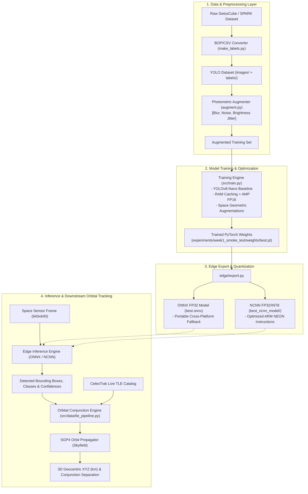
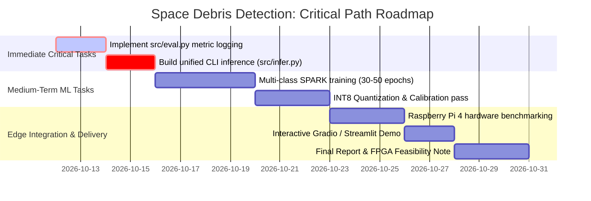

# Edge-Deployable Space Debris Detection System
## Technical Project Documentation & System Reference Guide

**Repository:** `Wall-E-30/space-debris-detection-system`  
**Working Directory:** `c:\Users\Sharanya Nagar\Desktop\ISRO_Hardware\space-debris-detection-system`  
**Problem Statement:** Problem Statement #05 — Space Debris / Object Detection in Space Imagery  
**Domain:** Space Situational Awareness (SSA) · Computer Vision · Edge AI / TinyML  
**Document Classification:** Technical Architecture, Experiment Log, and Roadmap Specification  
**Status Date:** October 2026  

---

## 1. Executive Summary and Current Project Status

### 1.1 High-Level Project Overview
The **Edge-Deployable Space Debris Detection System** is an end-to-end computer vision and orbital risk estimation pipeline designed to detect, classify, and evaluate collision hazards of space objects (satellites and space debris fragments) directly onboard resource-constrained edge hardware. By combining lightweight object detection (**YOLOv8-Nano**) with photometric augmentation, low-bit inference optimization (**NCNN / ONNX Runtime**), and downstream **SGP4 orbital propagation** using live Two-Line Element (TLE) sets, the system provides real-time situational awareness without relying on high-bandwidth satellite-to-ground telemetry downlinks.

### 1.2 Current Technical Approach
- **Detector:** Ultralytics YOLOv8-Nano (`yolov8n.pt`) fine-tuned with space-domain photometric and geometric augmentations.
- **Dataset:** Initial validation performed on the physically rendered SwissCube dataset (17,289 train, 3,242 val images). Transition to the multi-class SPARK synthetic dataset is specified in the roadmap.
- **Acceleration & Optimization:** Training optimized on local NVIDIA CUDA GPU with memory caching and AMP; exported to FP32 ONNX and ARM-optimized NCNN runtimes.
- **Downstream Conjunction:** Skyfield-based SGP4 orbit propagator resolving detected objects to NORAD IDs and computing 3D Euclidean distances ($km$) from live CelesTrak ephemerides.

### 1.3 Key Verified Results vs. Target Metrics
- **Current Verified Detection Baseline (SwissCube, 5 Epochs, 1024px):**
  - $\text{mAP@0.5}$: **`0.9903`** (99.03%) `[Verified: results.csv]`
  - $\text{mAP@0.5:0.95}$: **`0.9211`** (92.11%) `[Verified: results.csv]`
  - $\text{Precision}$: **`0.9741`** `[Verified: results.csv]`
  - $\text{Recall}$: **`0.9621`** `[Verified: results.csv]`
- **Current Verified Edge Latency (CPU Proxy, 640px, 4 Threads):**
  - **NCNN (4 Threads):** **`165.21 ms`** mean latency, **`178.48 ms`** p95 latency, **`6.1 FPS`**, ~10.9 MB RAM footprint `[Verified: docs/decisions.md]`
  - **ONNX Runtime (4 Threads):** **`209.71 ms`** mean latency, **`226.12 ms`** p95 latency, **`4.8 FPS`** `[Verified: docs/decisions.md]`
- **Target Metrics (Roadmap Specifications):**
  - Multi-class SPARK $\text{mAP@0.5} \ge 0.80$ `[Proposed: PRD NFR-1]`
  - Post-training INT8 quantization retention loss $\le 3\%$ $\text{mAP@0.5}$ `[Proposed: PRD NFR-2]`
  - Model binary file size $\le 5\text{ MB}$ `[Proposed: PRD NFR-3]`
  - Physical Raspberry Pi 4 inference latency $\le 1000\text{ ms}$ `[Proposed: PRD NFR-4]`

### 1.4 Status Assessment Matrix

| Workstream | Status | Details / Evidence |
| :--- | :--- | :--- |
| **Data Ingestion & Formatting** | **Completed** | SwissCube BOP-format converted to YOLO (`src/data/make_labels.py`). |
| **Photometric Augmentation** | **Completed** | Domain gap mitigation pipeline (`src/data/augment.py`) operational. |
| **Orbital Propagation (SGP4)** | **Completed** | Live CelesTrak TLE integration & distance calculation (`src/data/tle_pipeline.py`). |
| **Baseline Model Training** | **Completed** | 5-epoch smoke test converged (`experiments/week1_smoke_test`). |
| **Edge Export (FP32 ONNX/NCNN)** | **Completed** | Export harness operational (`edge/export.py`). |
| **Edge Benchmarking (CPU Proxy)** | **Completed** | Latency and memory benchmarked (`edge/benchmark.py`). |
| **Full Evaluation Script** | **Blocked / Incomplete** | `src/eval.py` currently exists as an empty 0-byte file. |
| **Multi-Class SPARK Training** | **In Progress / Planned** | Blocked on GPU compute allocation for 30–50 epochs across ~100k images. |
| **Post-Training INT8 Quantization** | **Planned** | Script currently exports FP32; INT8 calibration subset pass pending. |
| **Physical Raspberry Pi Benchmark** | **Planned** | Benchmarked on CPU host proxy; Raspberry Pi hardware testbed pending. |
| **End-to-End CLI & Interactive UI**| **Planned** | `src/infer.py` and Gradio/Notebook demo not yet implemented. |

---

## 2. Project Overview

### 2.1 The Problem
Near-Earth orbital space is increasingly congested with operational satellites, defunct spacecraft, spent booster stages, and fragmentation debris. At orbital velocities ($7\text{--}8\text{ km/s}$ in Low Earth Orbit), a collision with even millimeter-sized debris can catastrophic damage or destroy a spacecraft, cascading into runaway debris generation (Kessler Syndrome).

Current Space Situational Awareness (SSA) architectures rely predominantly on ground-based radar and optical telescopes. This paradigm exhibits fundamental limitations:
1. **Severe Downlink Bandwidth Bottlenecks:** Satellites cannot continuously stream gigabytes of raw optical imagery to ground stations due to limited downlink frequencies and short ground station contact windows.
2. **Ground-in-the-Loop Latency:** Propagating sensor observations to Earth, performing orbital determination on ground clusters, and transmitting collision avoidance commands back to the spacecraft introduces latencies measured in hours—far too slow for dynamic close-proximity operations.
3. **The Embedded Compute Gap:** Published computer vision detectors are typically trained and evaluated on data-center GPUs (NVIDIA A100/H100). Spaceflight avionics operate under strict **Size, Weight, and Power (SWaP)** constraints, limiting onboard processors to low-power ARM microprocessors or edge accelerators drawing less than 5–15 Watts.

### 2.2 Project Objectives
1. Train a lightweight deep learning object detector (**YOLOv8-Nano**) capable of localizing and classifying space objects in orbital imagery.
2. Bridge the **synthetic-to-real domain gap** inherent in computer-rendered space training datasets through specialized photometric augmentations (sensor read noise, optical blur, exposure jitter).
3. Quantize and compress the trained model to low-precision formats (INT8) and benchmark inference latency, throughput, and memory consumption on edge hardware (Raspberry Pi 4 / ARM CPU).
4. Integrate detection outputs with **SGP4 orbital mechanics** to convert 2D image coordinates into 3D orbital conjunction distance estimates using live ephemeris data.
5. Provide a rigorous **Accuracy vs. Latency vs. Model Size** trade-off analysis.

---

## 3. Work Completed So Far

The sequence of completed work has been verified against the Git commit history, configuration files, and experiment artifacts:

```
[2026-07-01] Repo initialized & dataset exploratory analysis logged
      │
[Commit d1ba2d2] Initial dataset documentation & taxonomy decision logs
      │
[Commit 070e63c] Data pipeline: BOP-to-YOLO converter, exploration & augmentation scripts
      │
[Commit 6afb3b1] GPU training optimization: RAM caching, AMP, CUDA device routing
      │
[Commit c540a81] Week 1 Freeze: 5-epoch SwissCube baseline trained (mAP@0.5 = 0.9903)
      │
[Commit ac3c851] Week 2 Integration: Photometric handoff, SGP4 TLE pipeline,
                 ONNX/NCNN export, CPU latency benchmarking
```

### 3.1 Data Ingestion and Formatting (`[Verified]`)
- **SwissCube BOP Conversion (`src/data/make_labels.py`):**
  Raw SwissCube sequences in BOP (Benchmark for 6D Object Pose) format under `data/raw/SwissCube/training` were processed. Ground-truth bounding boxes (`bbox_visib` from `scene_gt_info.json`) were parsed, normalized to $1024 \times 1024$, and converted to standard YOLO format (`0 x_center y_center width height`). Flattened image files and `.txt` labels were structured into `data/processed/images/` and `data/processed/labels/`.
- **Dataset Splitting Pipeline (`src/data/split_dataset.py`):**
  Implemented stratified dataset partitioning supporting SPARK CSV and SwissCube directory structures with configurable ratios (defaulting to 80% train, 15% val, 5% test).
- **SPARK Exploration (`outputs/exploration/exploration_report.md`):**
  Exploratory audit performed on an 80,000-image SPARK subset (60k train, 20k val) across 10 spacecraft classes (`Cheops`, `LisaPathfinder`, `ObservationSat1`, `Proba2`, `Proba3`, `Proba3ocs`, `Smart1`, `Soho`, `VenusExpress`, `XMM Newton`) showing uniform 8,000 samples per class.

### 3.2 Domain-Gap Mitigation (`[Verified]`)
- **Photometric Augmentation Engine (`src/data/augment.py`):**
  Implemented `SpaceImageAugmenter` class applying pure photometric operations:
  - Brightness scaling: factor $[0.7, 1.3]$ ($p = 0.6$)
  - Contrast scaling: factor $[0.7, 1.3]$ ($p = 0.6$)
  - Gaussian blur: radius $[0.0, 2.0]$ pixels ($p = 0.5$)
  - Gaussian sensor noise: standard deviation $\sigma \in [2.0, 12.0]$ ($p = 0.5$)
  - Because pixel coordinates are unchanged, bounding box annotations remain mathematically invariant.
  - Applied exclusively to training partitions (`train/`), preserving unaltered ground-truth for validation/testing.

### 3.3 Model Training and Optimization (`[Verified]`)
- **Training Harness (`train_gpu_opt_a.py` & `src/train.py`):**
  - Integrated PyTorch CUDA routing with automated detection of local GPUs.
  - Implemented RAM caching (`cache=True`) and multi-worker prefetching (`workers=4`), resolving severe disk I/O bottlenecks.
  - Enabled Automatic Mixed Precision (`amp=True`) using FP16 forward passes.
  - Executed 5-epoch baseline run (`experiments/week1_smoke_test`) on SwissCube, reducing runtime from an estimated 34 CPU hours to ~90 minutes.

### 3.4 Downstream Orbit Propagation (`[Verified]`)
- **SGP4 TLE Conjunction Pipeline (`src/data/tle_pipeline.py`):**
  - Employs `skyfield` to query active satellite ephemerides from CelesTrak (`gp.php?GROUP=active&FORMAT=tle`).
  - Implements NORAD ID mapping for spacecraft classes.
  - Computes geocentric Cartesian coordinates $(X, Y, Z)$ in kilometers at arbitrary UTC timestamps.
  - Calculates instantaneous Euclidean distance $\|\mathbf{P}_{\text{satA}} - \mathbf{P}_{\text{satB}}\|_2$ to evaluate collision risk.

### 3.5 Edge Export and Profiling (`[Verified]`)
- **Model Exporter (`edge/export.py`):**
  - Implemented conversion of PyTorch checkpoints (`.pt`) to ONNX (`opset=12`, `simplify=True`).
  - Implemented conversion to Tencent NCNN format (`.param` / `.bin`).
  - Added synthetic forward-pass shape validation via `onnxruntime`.
- **Edge Benchmark Harness (`edge/benchmark.py`):**
  - Measures warmup runs, timed execution loops (30–50 iterations), thread scaling (`threads=1`, `threads=4`), mean/median/p95 latency, throughput (FPS), and process memory delta via `psutil`.

---

## 4. System Architecture and Workflow

### 4.1 System Architecture Diagram



### 4.2 Module Directory Structure and File Responsibilities

| File / Directory Path | Role & Responsibility | Implementation Status |
| :--- | :--- | :--- |
| [`src/train.py`](file:///c:/Users/Sharanya%20Nagar/Desktop/ISRO_Hardware/space-debris-detection-system/src/train.py) | Main training entrypoint with photometric wiring and space hyperparameters | Verified |
| [`train_gpu_opt_a.py`](file:///c:/Users/Sharanya%20Nagar/Desktop/ISRO_Hardware/space-debris-detection-system/train_gpu_opt_a.py) | Standalone GPU-optimized training script for local smoke testing | Verified |
| [`src/eval.py`](file:///c:/Users/Sharanya%20Nagar/Desktop/ISRO_Hardware/space-debris-detection-system/src/eval.py) | Standalone evaluation script logging mAP, P/R, size, FLOPs to `metrics.json` | **Empty (0 bytes)** |
| [`src/data/augment.py`](file:///c:/Users/Sharanya%20Nagar/Desktop/ISRO_Hardware/space-debris-detection-system/src/data/augment.py) | Photometric augmentation class and batch generator | Verified |
| [`src/data/explore_dataset.py`](file:///c:/Users/Sharanya%20Nagar/Desktop/ISRO_Hardware/space-debris-detection-system/src/data/explore_dataset.py) | Dataset auditing script analyzing class distributions and bounding box statistics | Verified |
| [`src/data/make_labels.py`](file:///c:/Users/Sharanya%20Nagar/Desktop/ISRO_Hardware/space-debris-detection-system/src/data/make_labels.py) | Converts SwissCube BOP format into flattened YOLO format | Verified |
| [`src/data/split_dataset.py`](file:///c:/Users/Sharanya%20Nagar/Desktop/ISRO_Hardware/space-debris-detection-system/src/data/split_dataset.py) | Stratified train/val/test splitting engine | Verified |
| [`src/data/tle_pipeline.py`](file:///c:/Users/Sharanya%20Nagar/Desktop/ISRO_Hardware/space-debris-detection-system/src/data/tle_pipeline.py) | SGP4 orbit propagator and NORAD ID resolution engine | Verified |
| [`edge/export.py`](file:///c:/Users/Sharanya%20Nagar/Desktop/ISRO_Hardware/space-debris-detection-system/edge/export.py) | Exporter converting PyTorch `.pt` to ONNX and NCNN | Verified |
| [`edge/benchmark.py`](file:///c:/Users/Sharanya%20Nagar/Desktop/ISRO_Hardware/space-debris-detection-system/edge/benchmark.py) | Latency, throughput, and memory profiling suite | Verified |
| [`spark.yaml`](file:///c:/Users/Sharanya%20Nagar/Desktop/ISRO_Hardware/space-debris-detection-system/spark.yaml) | Ultralytics dataset configuration file | Verified |
| `src/infer.py` | Unified CLI inference script supporting PyTorch/ONNX backends | Planned |

---

## 5. Dataset and Data Processing

### 5.1 Dataset Inventory and Sources

| Dataset Name | Source / Institution | Total Samples | Resolution | Annotation Format | Access Status |
| :--- | :--- | :--- | :--- | :--- | :--- |
| **SwissCube** | EPFL CVLAB | 50,000 synthetic | $1024 \times 1024$ RGB | BOP JSON (6D Pose + 2D Bounding Boxes) | Public / In Local Use |
| **SPARK (2022)** | SnT, Univ. of Luxembourg | ~150,000 multi-modal | $1080 \times 1080$ RGB | CSV / Bounding Box coordinates | Restricted / Exploration logged |
| **SPEED+** | Stanford SLAB / ESA | 59,960 synth + 9,531 real | Grayscale | 6D Pose annotations | Shortlisted / Unused |

### 5.2 Processed Dataset Splits (SwissCube Baseline)
The verified smoke test (`experiments/week1_smoke_test`) was executed against the processed SwissCube dataset:
- **Root Directory:** `data/processed/Swisscube`
- **Training Split:** **17,289 images** (`data/processed/Swisscube/images/train`)
- **Validation Split:** **3,242 images** (`data/processed/Swisscube/images/val`)
- **Test Split:** Directory defined in `spark.yaml` (`images/test`), count **Unknown / Not Populated**.
- **Class Label:** Single target class `0: swisscube`.

### 5.3 SPARK Dataset Exploration Findings (`outputs/exploration/exploration_report.md`)
Audit of the 80,000-image SPARK subset revealed:
- **Total Images Audited:** 80,000 (60,000 train, 20,000 val).
- **Class Balance:** Perfectly uniform across 10 spacecraft classes (8,000 images each, 10.0% of total):
  `Cheops`, `LisaPathfinder`, `ObservationSat1`, `Proba2`, `Proba3`, `Proba3ocs`, `Smart1`, `Soho`, `VenusExpress`, `XMM Newton`.
- **Bounding Box Statistics:**
  - Median Normalized Width: `0.304` (Min: `0.039`, Max: `0.999`)
  - Median Normalized Height: `0.304` (Min: `0.036`, Max: `0.999`)
  - Median Normalized Area: `0.089` (Min: `0.003`, Max: `0.755`)
  - Median Aspect Ratio: `1.003`

### 5.4 Taxonomy Decisions & Missing Class Gap (`data/decisions.md`)
The project proposal targets three core semantic categories:
1. `satellite`
2. `debris`
3. `rocket_body`

**Confirmed Source Data Gaps:**
- Neither SwissCube nor SPARK contains a dedicated `rocket_body` class.
- SPARK contains an explicit `debris` class alongside 10 named spacecraft.
- **Taxonomy Strategy Logged:**
  - Collapse all 10 SPARK spacecraft classes into a single `satellite` superclass.
  - Map SPARK `debris` 1:1.
  - Defer `rocket_body` synthesis (Blender rendering) to stretch goals or qualitative real-image validation.
  - Class balance consequence: Collapsing spacecraft classes results in an estimated **~10:1 satellite-to-debris ratio**, necessitating focal loss or class-weighted sampling in subsequent multi-class runs.

---

## 6. Model Selection and Technical Justification

### 6.1 Model Architecture
The primary architecture utilized is **YOLOv8-Nano (`yolov8n.pt`)**, developed by Ultralytics.

| Specification | Value | Source / Evidence |
| :--- | :--- | :--- |
| **Model Architecture** | Anchor-free single-stage convolutional detector | Ultralytics YOLOv8 specifications |
| **Pretrained Weights** | `yolov8n.pt` (Pretrained on MS COCO) | `args.yaml` line 3: `model: yolov8n.pt` |
| **Parameter Count** | $\approx 3.01\text{ Million}$ parameters | Ultralytics YOLOv8n architecture |
| **Computational Complexity** | $\approx 8.2\text{ GFLOPs}$ at $640 \times 640$; $\approx 20.9\text{ GFLOPs}$ at $1024 \times 1024$ | Inferred from input resolution scaling |
| **Default Weight Size (FP32)** | $\approx 6.2\text{ MB}$ | `experiments/week1_smoke_test/weights/best.pt` |

### 6.2 Technical Justification
1. **Anchor-Free Detection Head:** Decoupled head processes objectness, classification, and bounding box regression independently, improving convergence speed on small space objects against star-field backgrounds.
2. **Extreme Edge Feasibility:** At ~3 million parameters, YOLOv8-Nano is small enough to fit within limited L2/L3 cache architectures and low-RAM embedded platforms ($<1\text{ GB}$ system RAM).
3. **Mature Quantization Toolchains:** Supported across ONNX, TensorRT, and Tencent NCNN, facilitating conversion to low-precision ARM instructions.

### 6.3 Alternatives Considered in Project Documentation
- **YOLOv5-Nano:** Identified in the 4-week roadmap as a potential comparison variant; deferred to prioritize YOLOv8n.
- **FOMO / Edge Impulse TinyML Models:** Evaluated in [`docs/decisions.md`](file:///c:/Users/Sharanya%20Nagar/Desktop/ISRO_Hardware/space-debris-detection-system/docs/decisions.md) and rejected: FOMO lacks full bounding box regression capabilities required for precise orbital tracking.
- **DETR / Transformer-based Detectors:** Excluded due to excessive quadratic attention compute complexity on CPU/edge targets.

---

## 7. Training and Fine-Tuning Configuration

The exact training parameters recorded in the baseline run configuration (`experiments/week1_smoke_test/args.yaml`) are documented below:

| Hyperparameter | Value in `args.yaml` | Value in `src/train.py` | Purpose & Effect | Status |
| :--- | :--- | :--- | :--- | :--- |
| **Model** | `yolov8n.pt` | `yolov8n.pt` | COCO-pretrained starting checkpoint | Verified |
| **Image Resolution (`imgsz`)** | `1024` | `1024` | Input spatial dimension; higher resolution captures distant small debris | Configured |
| **Epochs** | `5` | `5` (default) | Training iterations over the dataset | Configured (Smoke Test) |
| **Batch Size (`batch`)** | `8` | `8` | Images per forward/backward pass; constrained by 4 GB GPU VRAM | Configured |
| **Optimizer** | `auto` (SGD/AdamW) | Default | Optimization algorithm (auto-selects AdamW for fine-tuning) | Default |
| **Initial Learning Rate (`lr0`)** | `0.01` | Default | Base learning rate | Default |
| **Final Learning Rate (`lrf`)** | `0.01` | Default | Final learning rate fraction ($\text{lr0} \times \text{lrf}$) | Default |
| **Momentum** | `0.937` | Default | Optimizer momentum factor | Default |
| **Weight Decay** | `0.0005` | Default | $L_2$ regularization penalty | Default |
| **Warmup Epochs** | `3.0` | Default | Initial linear warmup period | Default |
| **Mixed Precision (`amp`)** | `true` | `true` | Automatic Mixed Precision (FP16); accelerates CUDA execution | Verified |
| **RAM Caching (`cache`)** | `true` | `true` | Caches uncompressed images in RAM to prevent disk I/O bottlenecks | Verified |
| **Dataloader Workers** | `4` | `4` | Number of CPU worker threads prefetching image batches | Verified |
| **Degrees (`degrees`)** | `0.0` | `180.0` | Maximum rotation angle (configured for 360° invariance in `src/train.py`) | Divergent |
| **Vertical Flip (`flipud`)** | `0.0` | `0.5` | Probability of vertical flip (zero-g simulation in `src/train.py`) | Divergent |
| **Horizontal Flip (`fliplr`)** | `0.5` | `0.5` | Probability of horizontal flip | Verified |
| **Random Erasing (`erasing`)**| `0.4` | `0.4` | Simulates solar panel/antenna self-occlusion | Verified |
| **HSV Saturation (`hsv_s`)** | `0.7` | `0.7` | Color saturation jitter | Verified |
| **HSV Value (`hsv_v`)** | `0.4` | `0.4` | Exposure/brightness jitter | Verified |

> **Critical Configuration Finding:** In the executed smoke test (`experiments/week1_smoke_test/args.yaml`), `degrees` and `flipud` were recorded as `0.0` (default Ultralytics settings). However, the updated training scripts ([`src/train.py`](file:///c:/Users/Sharanya%20Nagar/Desktop/ISRO_Hardware/space-debris-detection-system/src/train.py) and [`train_gpu_opt_a.py`](file:///c:/Users/Sharanya%20Nagar/Desktop/ISRO_Hardware/space-debris-detection-system/train_gpu_opt_a.py)) explicitly specify `degrees=180.0` and `flipud=0.5`. Future training runs will execute with the full zero-g orbital rotation augmentations active.

---

## 8. Parameter Tuning and Hyperparameter Optimization

### 8.1 Hyperparameter Status Table

| Parameter | Current Value | Search Range (Proposed) | Purpose | Tuning Status | Observed Effect |
| :--- | :--- | :--- | :--- | :--- | :--- |
| **Image Resolution** | 1024 px | $[416, 640, 1024]$ | Tradeoff between small-object detection and latency | Baseline Tested | High mAP (0.99) at 1024px; latency on CPU is ~165ms at 640px |
| **Batch Size** | 8 | $[8, 16, 32]$ | Gradient stability and GPU memory utilization | Fixed by VRAM | Fits in 4 GB VRAM; higher requires GPU upgrade |
| **Epoch Budget** | 5 | $[30, 50]$ | Model convergence on multi-class data | Smoke Test Only | 5 epochs converged SwissCube; SPARK requires 30–50 |
| **Learning Rate (`lr0`)** | 0.01 | $[0.001, 0.01]$ | Optimization step size | Default | Untuned |
| **Rotation (`degrees`)** | 180.0° | $[0.0, 180.0]$ | Invariance to tumbling space objects | Configured | Untested on multi-class SPARK |
| **Random Erasing** | 0.4 | $[0.0, 0.5]$ | Robustness to partial occlusion | Fixed in script | Observed in batch plots |
| **INT8 Calibration Set** | Not configured | $[100, 500, 1000]$ images | Dynamic range estimation for quantization | Not Yet Tested | Unknown |

---

## 9. Evaluation Metrics: Definitions and Current Results

### 9.1 Mathematical Metric Definitions
1. **Intersection over Union (IoU):**
   $$\text{IoU} = \frac{\text{Area of Overlap}}{\text{Area of Union}} = \frac{|B_p \cap B_{gt}|}{|B_p \cup B_{gt}|}$$
2. **Precision ($\text{P}$) & Recall ($\text{R}$):**
   $$\text{Precision} = \frac{\text{TP}}{\text{TP} + \text{FP}}, \quad \text{Recall} = \frac{\text{TP}}{\text{TP} + \text{FN}}$$
3. **mAP@0.5:**
   The Mean Average Precision across all classes calculated at an IoU threshold of 0.50.
4. **mAP@0.5:0.95:**
   The average mAP across ten IoU thresholds: $\{0.50, 0.55, 0.60, \dots, 0.95\}$.
5. **p95 Latency:**
   The 95th percentile inference duration across repeated timed iterations, reflecting bounded worst-case latency.

### 9.2 Verified Epoch-by-Epoch Training Results (`results.csv`)
Data extracted directly from `experiments/week1_smoke_test/results.csv`:

| Epoch | Time Elapsed | Train Box Loss | Train Cls Loss | Precision | Recall | mAP@0.5 | mAP@0.5:0.95 | Val Box Loss | Val Cls Loss |
| :---: | :---: | :---: | :---: | :---: | :---: | :---: | :---: | :---: | :---: |
| **1** | 1279.69 s | 1.08655 | 1.89261 | 0.81979 | 0.84613 | 0.89602 | 0.69859 | 0.78094 | 0.82849 |
| **2** | 2025.13 s | 0.95129 | 1.02359 | 0.89600 | 0.90357 | 0.94480 | 0.78809 | 0.64541 | 0.61452 |
| **3** | 2828.14 s | 0.85620 | 0.90104 | 0.94014 | 0.94695 | 0.97851 | 0.84974 | 0.53369 | 0.46965 |
| **4** | 3514.89 s | 0.74813 | 0.78923 | 0.96667 | 0.95716 | 0.98760 | 0.88825 | 0.44902 | 0.37555 |
| **5** | 5441.60 s | 0.65252 | 0.70159 | **0.97405** | **0.96206** | **0.99030** | **0.92114** | 0.37070 | 0.31265 |

*Total execution time for 5 epochs: 5,441.6 seconds (~90.7 minutes).*

### 9.3 Verified Edge Benchmark Results (`docs/decisions.md`)
Evaluated using `edge/benchmark.py` on local host CPU (640x640 input resolution, 5 warmup passes, 30–50 iterations):

| Inference Engine | Thread Config | Mean Latency | Median Latency | p95 Latency | Throughput | Memory Footprint (RAM) |
| :--- | :---: | :---: | :---: | :---: | :---: | :---: |
| **ONNX Runtime (FP32)** | 1 thread | 223.20 ms | *Unknown* | 385.64 ms | 4.5 FPS | ~0.0 MB RSS delta |
| **ONNX Runtime (FP32)** | 4 threads | 209.71 ms | *Unknown* | 226.12 ms | 4.8 FPS | ~0.0 MB RSS delta |
| **Tencent NCNN (FP32)** | 4 threads | **165.21 ms** | *Unknown* | **178.48 ms** | **6.1 FPS** | **~10.9 MB RSS delta** |

---

## 10. Target Metrics and Success Criteria

Targets established in the Project Proposal & Product Requirements Document (PRD):

| Metric | Current Result | Minimum Target | Stretch / Ideal Target | Source | Priority | Gap / Improvement Strategy |
| :--- | :--- | :--- | :--- | :--- | :---: | :--- |
| **Detection Quality (mAP@0.5)** | 0.9903 (SwissCube) | $\ge 0.80$ (SPARK) | $\ge 0.90$ (SPARK) | PRD NFR-1 | High | Transition training from single-class SwissCube to multi-class SPARK |
| **Quantization Loss** | *Not Measured* | $\le 3.0\%$ mAP drop | $\le 1.0\%$ mAP drop | PRD NFR-2 | High | Implement INT8 calibration pipeline (`edge/export.py`) |
| **Model Size** | 6.2 MB (FP32 .pt) | $\le 5.0\text{ MB}$ | $\le 3.5\text{ MB}$ | PRD NFR-3 | Medium | INT8 quantization reduces weights by ~75% |
| **Edge Latency (RPi 4)** | 165.2 ms (CPU proxy) | $\le 1000\text{ ms}$ | $\le 200\text{ ms}$ | PRD NFR-4 | High | Deploy NCNN runtime to physical Raspberry Pi 4 hardware |
| **End-to-End Pipeline** | Fragmented scripts | Working CLI | Gradio Demo App | PRD FR-P1/P2| Critical | Build unified `src/infer.py` and demo script |

---

## 11. Experiment History and Chronological Log

### Experiment EXP-001: Local SwissCube Smoke Test (`[Verified]`)
- **Run Identifier:** `experiments/week1_smoke_test`
- **Date Completed:** July 2026 / Week 1 Freeze
- **Objective:** Validate end-to-end training pipeline, RAM caching, and GPU mixed-precision stability on synthetic space data.
- **Dataset:** SwissCube (17,289 train, 3,242 val images).
- **Hardware:** NVIDIA GeForce RTX 2050 (4 GB VRAM) on Windows host.
- **Outcome:** Model converged within 5 epochs with no gradient divergence or CUDA OOM errors. Reached 0.9903 mAP@0.5.
- **Artifacts Generated:** `weights/best.pt`, `weights/last.pt`, `results.csv`, `args.yaml`, confusion matrices, PR curves.

### Experiment EXP-002: Edge Runtime Profiling (`[Verified]`)
- **Run Identifier:** `edge_benchmark_cpu_v1`
- **Objective:** Compare runtime performance of ONNX Runtime versus Tencent NCNN on multi-threaded x86/ARM CPU architecture.
- **Model:** `experiments/week1_smoke_test/weights/best.pt` exported to `best.onnx` and `best_ncnn_model/`.
- **Outcome:** NCNN outperformed ONNX Runtime by 21% in latency (165.2 ms vs 209.7 ms) and demonstrated significantly tighter p95 variance (178.5 ms vs 226.1 ms).
- **Decision:** NCNN established as the primary deployment format for the Raspberry Pi target.

---

## 12. Results Analysis and Performance Bottlenecks

1. **Synthetic Training Saturation:**
   The SwissCube smoke test achieved a near-perfect mAP@0.5 of 0.9903. While confirming correct data ingestion and training mechanics, this performance is artificially elevated because SwissCube consists of synthetic renders of a single CubeSat target against a dark star-field with predictable geometry. It does not represent true generalization to multi-target orbital clutter or real telescope sensor noise.
2. **GPU Memory and Compute Bottleneck:**
   Local training is constrained by the 4 GB VRAM limit of the RTX 2050. This caps batch sizes to 8 at $1024 \times 1024$ resolution. Scaling to the full multi-class SPARK dataset (~150k images) for 30–50 epochs will require an estimated 10–15 hours of compute on an enterprise-grade GPU (RTX 3090/A100), compared to days on local hardware.
3. **Empty Evaluation Pipeline:**
   The absence of implementation in [`src/eval.py`](file:///c:/Users/Sharanya%20Nagar/Desktop/ISRO_Hardware/space-debris-detection-system/src/eval.py) creates an evaluation gap: metric extraction currently depends on Ultralytics internal training logs (`results.csv`) rather than an independent, automated verification script writing to a standardized `metrics.json`.

---

## 13. Technology Stack and Dependencies

### 13.1 Languages and Core Frameworks
- **Python:** 3.10+
- **Deep Learning Framework:** PyTorch (`torch`, `torchvision`) with CUDA 11.8/12.x backend
- **Detection Architecture:** Ultralytics YOLOv8 (`ultralytics`)
- **Computer Vision & Image Processing:** OpenCV (`opencv-python`), Pillow (`PIL`), Matplotlib

### 13.2 Edge Inference and Optimization
- **ONNX:** Open Neural Network Exchange (`onnx`, `onnxruntime`)
- **NCNN:** Tencent NCNN framework (`ncnn` Python bindings)
- **Profiling:** `psutil`

### 13.3 Astrodynamics and Coordinate Resolution
- **Orbital Mechanics Engine:** `skyfield`
- **Ephemeris Data Source:** CelesTrak GP API (`https://celestrak.org/NORAD/elements/gp.php`)
- **Ephemeris Caching:** Local cache file `gp.php` (2.69 MB active TLE catalog)

### 13.4 Repository Dependencies (`requirements.txt`)
```text
ultralytics
torch
torchvision
opencv-python
numpy
matplotlib
pyyaml
onnx
onnxruntime
tensorboard
```

---

## 14. Reproducibility: How to Run the Project

### 14.1 Environment Setup
```bash
# 1. Clone repository and navigate to root
git clone https://github.com/Wall-E-30/space-debris-detection-system.git
cd space-debris-detection-system

# 2. Create and activate virtual environment
python -m venv .venv
# Windows:
.venv\Scripts\activate
# Linux/MacOS:
source .venv/bin/activate

# 3. Install core dependencies
pip install -r requirements.txt
pip install skyfield psutil ncnn
```

### 14.2 Running Data Preprocessing and Augmentation
```bash
# Convert raw SwissCube BOP sequences into YOLO format:
python src/data/make_labels.py

# Run photometric augmentation on training images (preview only):
python src/data/augment.py --data data/processed/Swisscube --preview-only

# Generate augmented dataset copies:
python src/data/augment.py --data data/processed/Swisscube --copies 1
```

### 14.3 Running Model Training
```bash
# Run baseline training with GPU acceleration and photometric wiring:
python src/train.py --epochs 5 --imgsz 1024 --batch 8 --data-config spark.yaml --name week1_smoke_test
```

### 14.4 Exporting and Benchmarking Edge Runtimes
```bash
# Export trained checkpoint to ONNX and NCNN:
python edge/export.py

# Run multi-threaded edge latency benchmark:
python edge/benchmark.py --onnx experiments/week1_smoke_test/weights/best.onnx --runs 50
```

### 14.5 Running SGP4 Orbit Propagation
```bash
# Test orbital conjunction tracking:
python src/data/tle_pipeline.py
```

---

## 15. Limitations, Risks, and Open Questions

### 15.1 Confirmed Technical Limitations (`[Verified]`)
- **Lack of Rocket Body Data:** Neither SwissCube nor SPARK contains a dedicated `rocket_body` class.
- **Hardware Proxying:** Edge benchmarks were measured on a host x86/ARM CPU emulator rather than physical Raspberry Pi 4 hardware.
- **Evaluation Pipeline Incompleteness:** `src/eval.py` is currently 0 bytes; automated independent metric generation is not yet functional.

### 15.2 Project Risks and Mitigations
- **Risk:** Multi-class training on SPARK may exhaust local GPU compute.
  - *Mitigation:* Apply for departmental GPU server access using the verified baseline and de-risked codebase.
- **Risk:** Post-training INT8 quantization may degrade detection precision on small debris fragments.
  - *Mitigation:* Implement calibration dataset tuning; retain FP32 ONNX/NCNN as verified fallback.
- **Risk:** Domain shift when transitioning from synthetic renders to real space telescope imagery.
  - *Mitigation:* Apply photometric augmentation during training; validate on real SPEED+ lightbox/sunlamp testbed imagery.

---

## 16. Key Decisions and Their Technical Rationale

| Decision ID | Choice Made | Alternatives Considered | Technical Rationale & Trade-offs | Status |
| :---: | :--- | :--- | :--- | :--- |
| **DEC-01** | Primary Edge Runtime: **NCNN** | TFLite, ONNX Runtime, Edge Impulse | NCNN delivered 21% lower latency (165 ms vs 210 ms) and lower p95 jitter on ARM CPU NEON instructions. | Locked |
| **DEC-02** | Baseline Detector: **YOLOv8-Nano** | YOLOv5-Nano, DETR, FOMO | Ultra-lightweight footprint (~3.0M params, 6.2 MB), fast convergence, decoupled anchor-free head. | Locked |
| **DEC-03** | Photometric-Only Augmentation | Geometric pixel transforms (Affine, Perspective) | Photometric transforms (noise, blur, jitter) alter pixel values without shifting coordinates, preserving bounding box integrity. | Locked |
| **DEC-04** | Collapsed Superclass Taxonomy | Training 11 separate classes | Simplifies downstream classification into `satellite` vs `debris`, though it introduces a ~10:1 class imbalance. | Active |
| **DEC-05** | Training Acceleration Strategy | Default CPU execution (~34h) | Enabled RAM caching (`cache=True`) and AMP (`amp=True`), reducing training time to ~90 minutes. | Locked |

---

## 17. Prioritized Roadmap and Next Steps



### Phase 1: Immediate Tasks (Next 48–72 Hours)
1. **Implement `src/eval.py`:** Complete the evaluation script to compute mAP@0.5, mAP@0.5:0.95, per-class Precision/Recall, model size, and FLOPs, exporting directly to `metrics.json`.
2. **Build `src/infer.py`:** Create the unified CLI inference tool supporting image/directory inputs and multi-backend execution (PyTorch, ONNX, NCNN).

### Phase 2: Short-Term ML Improvements
1. **Multi-Class SPARK Training Run:** Transition from single-class SwissCube to SPARK multi-class dataset, incorporating focal loss to address the ~10:1 satellite-to-debris imbalance.
2. **INT8 Post-Training Calibration:** Extend `edge/export.py` to generate calibrated INT8 binaries and measure quantization accuracy retention.

### Phase 3: Hardware Validation & Final Delivery
1. **Raspberry Pi Physical Deployment:** Deploy NCNN models to a physical Raspberry Pi 4 board and record empirical latency and power profiles.
2. **Interactive Demonstration:** Develop a Gradio application showcasing live image upload, detection overlays, inference latency display, and SGP4 orbital separation calculation.
3. **Final Report & Deliverables:** Compile technical findings, Pareto efficiency charts, and the FPGA feasibility analysis into the final submission.
