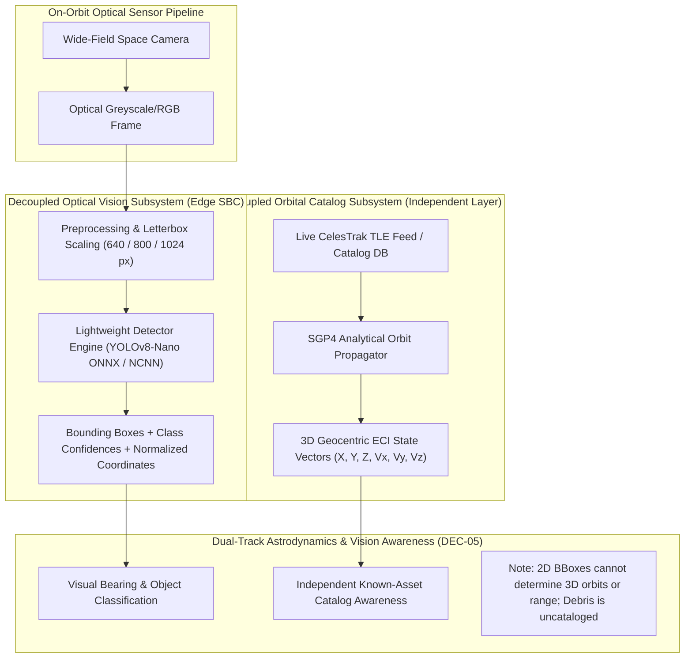
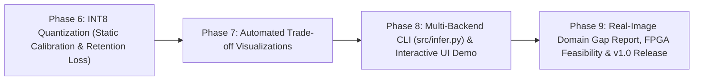

# Master Technical Report: Edge-Deployable Space Debris Detection System
## End-to-End Mission Architecture, Empirical Findings, Hardware Benchmarks & Strategic Roadmap

**Project:** ISRO Hardware & Edge Vision Challenge (Problem Statement #05)  
**Repository:** [space-debris-detection-system](file:///c:/Users/Sharanya%20Nagar/Desktop/ISRO_Hardware/space-debris-detection-system)  
**Authors:** Edge Vision & Machine Learning Team  
**Date:** October 23, 2026  
**Status:** **Active Milestone Document (Post-Physical Hardware Validation)**  

---

## 1. Executive Summary & Mission Charter

### 1.1 What We Are Doing
We are designing, training, evaluating, and deploying an **edge-deployable computer vision system** capable of real-time multi-class object detection and classification for space situational awareness (SSA). The system detects both **operational spacecraft (10 satellite classes)** and **space debris fragments (5 synthetic geometric CAD categories)** in wide-field orbital optical imagery. 

The vision pipeline is powered by an optimized **YOLOv8-Nano** architecture ($3.14\text{M parameters}$, $8.8\text{ GFLOPs}$ at $640\text{px}$, $22.4\text{ GFLOPs}$ at native $1024\text{px}$), exported to hardware-portable **ONNX** and ARM-vectorized **NCNN** formats, and validated directly on physical edge Single Board Computers (**Raspberry Pi 5**; Raspberry Pi 4 pending). It is coupled with an **independent SGP4 orbital tracking catalog layer** that provides geocentric ephemeris propagation for known satellite assets without conflating 2D visual bounding boxes with 3D physical orbit determination.

### 1.2 Core Engineering Value
Rather than optimizing solely for isolated benchmark scores on high-power workstation GPUs, our core value is **an honest, empirical accuracy-versus-deployability tradeoff** measured directly on target embedded edge hardware. Every latency, memory, and throughput figure in this project is grounded in reproducible physical measurements rather than theoretical extrapolation.

---

## 2. Why We Are Doing It: The Problem & Engineering Context

### 2.1 The Space Situational Awareness Crisis
Low Earth Orbit (LEO) is experiencing exponential congestion driven by mega-constellations and fragmentation events:
* **The Kessler Syndrome Threat:** Millions of untracked fragments travel at orbital velocities exceeding $7.5\text{ km/s}$ ($>27,000\text{ km/h}$). At these velocities, a collision with a millimeter-scale particle releases kinetic energy comparable to an explosive shell, threatening operational spacecraft and human spaceflight missions.
* **Limitations of Ground-Based Radar & Telescopes:** Ground tracking networks (e.g., Space Surveillance Network) face coverage gaps, atmospheric attenuation, weather constraints, and resolution limits below $10\text{ cm}$.
* **The Need for Autonomous On-Orbit Vision:** Future satellites, active debris removal (ADR) chasers, and servicing vehicles require **on-board autonomous optical perception** to detect approaching orbital bodies in real time, independent of ground station communication passes.

### 2.2 Problem Statement #05 Mandate & Physical Constraints
Deploying computer vision models into the space domain imposes severe operational constraints:
1. **Severe Power & Thermal Envelope:** Spaceborne computers and CubeSat payloads operate under strict power limits ($\le 5\text{W} - 15\text{W}$) and vacuum thermal dissipation constraints. High-end desktop GPUs cannot survive or operate within these budgets.
2. **Strict Real-Time Latency Gate:** The team-defined operational requirement targets inference latency **$\le 1000\text{ ms}$ (1 second)** on real edge SBC hardware to allow on-board flight software to process camera frames and execute avoidance heuristics. (Validated on Raspberry Pi 5; physical Raspberry Pi 4 gate remains open).
3. **Severe Memory & Model Footprint Limits:** Embedded flash storage and RAM on space-grade rad-hard computers are constrained; models must maintain a peak memory footprint under $500\text{ MB}$ and binary sizes $\le 15\text{ MB}$ (with INT8 quantization targeting $\le 4\text{ MB}$).
4. **The Optical Domain Gap:** Synthetic space imagery features uniform solid black backgrounds ($>95\%$ zero pixels), extreme contrast, intense solar glint, absence of atmospheric scatter, and significant optical sensor read noise.

---

## 3. End-to-End System Architecture

The system decouples visual detection from orbital mechanics to preserve physical rigor:



### 3.1 Architectural Principles
* **Separation of Concerns ([DEC-05](file:///c:/Users/Sharanya%20Nagar/Desktop/ISRO_Hardware/space-debris-detection-system/docs/decisions.md#dec-05-tle-independent-catalog-layer--uncataloged-debris-limitation)):** A single 2D bounding box from a mono-camera cannot physically determine 3D orbital velocity or Keplerian elements without range sensing or multi-station tracklet association. The SGP4 pipeline ([src/data/tle_pipeline.py](file:///c:/Users/Sharanya%20Nagar/Desktop/ISRO_Hardware/space-debris-detection-system/src/data/tle_pipeline.py)) operates strictly as an independent catalog awareness layer for known satellites.
* **Uncataloged Space Debris Treatment:** Debris fragments have **no NORAD IDs in CelesTrak**. The system explicitly flags detected debris as uncataloged and triggers visual proximity warnings rather than attempting impossible TLE propagation.
* **Multi-Scale Deployability ([DEC-07](file:///c:/Users/Sharanya%20Nagar/Desktop/ISRO_Hardware/space-debris-detection-system/docs/decisions.md#dec-07-model-input-resolution--multi-scale-trade-off-strategy)):** The detector is trained at native high resolution ($1024\text{px}$) on the workstation, while inference supports dynamic scale adaptation ($640\text{px}$, $800\text{px}$, $1024\text{px}$) to balance accuracy against available compute.

---

## 4. Everything Done So Far & Comprehensive Results

### Stage 1: Phase 1 Foundations & Baseline Smoke Test
* **Standalone Evaluation Harness:** Implemented [src/eval.py](file:///c:/Users/Sharanya%20Nagar/Desktop/ISRO_Hardware/space-debris-detection-system/src/eval.py), decoupling evaluation from training scripts and establishing standardized `metrics.json` outputs. Verified reproduction of the baseline SwissCube smoke test: **0.9903 mAP@0.5**, **0.9211 mAP@0.5:0.95**.
* **Repository & Dependency Hygiene:** Created [requirements-edge.txt](file:///c:/Users/Sharanya%20Nagar/Desktop/ISRO_Hardware/space-debris-detection-system/requirements-edge.txt), pinned host requirements (`skyfield`, `psutil`, `onnxruntime`, `ncnn`), gitignored volatile TLE caches, and established dataset contracts.

---

### Stage 2: SPARK Annotation Audit & The Debris Restoration Pivot
* **The Zero-Debris Discovery ([DEC-04](file:///c:/Users/Sharanya%20Nagar/Desktop/ISRO_Hardware/space-debris-detection-system/docs/decisions.md#dec-04-spark-dataset-annotation-audit--debris-taxonomy-resolution)):** On Day 1, [scripts/audit_spark_annotations.py](file:///c:/Users/Sharanya%20Nagar/Desktop/ISRO_Hardware/space-debris-detection-system/scripts/audit_spark_annotations.py) audited all $80,000$ label rows of the initial SPARK release and confirmed **exactly 0 space debris annotations**. It was exclusively a 10-class satellite dataset.
* **Transition to SPARK-2021 ([DEC-10](file:///c:/Users/Sharanya%20Nagar/Desktop/ISRO_Hardware/space-debris-detection-system/docs/decisions.md#dec-10-transition-to-spark-2021-11-class-dataset-synthetic-debris-integration)):** Upgraded to the official **SPARK-2021 dataset** ($150,000$ images). The comprehensive audit ([scripts/audit_spark2021_annotations.py](file:///c:/Users/Sharanya%20Nagar/Desktop/ISRO_Hardware/space-debris-detection-system/scripts/audit_spark2021_annotations.py)) verified **$25,000$ confirmed ground-truth debris annotations** across 5 geometric debris types alongside $125,000$ spacecraft labels across 10 satellite classes:

| Class ID | Class Name | Train Rows | Val Rows | Test Rows | Total Verified Rows | Object Type |
|:---:|---|:---:|:---:|:---:|:---:|---|
| **0** | `AcrimSat` | 7,500 | 2,500 | 2,500 | 12,500 | Operational Satellite |
| **1** | `Aquarius` | 7,500 | 2,500 | 2,500 | 12,500 | Operational Satellite |
| **2** | `Aura` | 7,500 | 2,500 | 2,500 | 12,500 | Operational Satellite |
| **3** | `Calipso` | 7,500 | 2,500 | 2,500 | 12,500 | Operational Satellite |
| **4** | `Cloudsat` | 7,500 | 2,500 | 2,500 | 12,500 | Operational Satellite |
| **5** | `CubeSat` | 7,500 | 2,500 | 2,500 | 12,500 | Miniature Satellite |
| **6** | `Debris` | **15,000** | **5,000** | **5,000** | **25,000** | **Synthetic Space Debris (5 CAD Models)** |
| **7** | `Jason` | 7,500 | 2,500 | 2,500 | 12,500 | Operational Satellite |
| **8** | `Sentinel-6` | 7,500 | 2,500 | 2,500 | 12,500 | Operational Satellite |
| **9** | `Terra` | 7,500 | 2,500 | 2,500 | 12,500 | Operational Satellite |
| **10** | `TRMM` | 7,500 | 2,500 | 2,500 | 12,500 | Operational Satellite |
| **Total** | **11 Classes** | **90,000** | **30,000** | **30,000** | **150,000** | **Complete Dataset Corpus** |

* **Dataset Conversion:** Implemented [scripts/convert_spark2021_to_yolo.py](file:///c:/Users/Sharanya%20Nagar/Desktop/ISRO_Hardware/space-debris-detection-system/scripts/convert_spark2021_to_yolo.py) resolving the row/column coordinate format `[R_min, C_min, R_max, C_max]` into normalized YOLO center coordinates `[class_id, cx, cy, w, h]` with NTFS hardlinking.

---

### Stage 3: Space-Domain Photometric Augmentation
* **Pipeline Design ([src/data/augment.py](file:///c:/Users/Sharanya%20Nagar/Desktop/ISRO_Hardware/space-debris-detection-system/src/data/augment.py)):** To bridge the synthetic rendering domain gap, we engineered an offline photometric augmentation pipeline injecting:
  - Solar Exposure Jitter: Contrast scaling $\alpha \in [0.7, 1.3]$
  - Optical Defocus Blur: Gaussian kernel $\sigma \in [0.0, 2.0]$
  - Sensor Read Noise: Gaussian noise $\sigma \in [2.0, 12.0]$
* **Strict Split Isolation Gate:** Photometric augmentation was applied **exclusively to the 90,000 raw training images**, doubling the training set to **180,000 images** (`aug1_*`). Exactly zero augmented images exist in `val/` or `test/`. (Note: Trajectory-level sequence leakage across raw splits is not ruled out due to dHash collapse).

---

### Stage 4: Split Leakage Audit & Black-Space Hashing Investigation
* **Perceptual Hash Audit ([scripts/check_split_leakage.py](file:///c:/Users/Sharanya%20Nagar/Desktop/ISRO_Hardware/space-debris-detection-system/scripts/check_split_leakage.py)):** Executed 64-bit difference hashing (dHash) comparing test images against training samples.
* **Critical Finding (Background Hash Collapse):** Space images consist of $>95\%$ uniform solid black background ($\text{RGB} = [0, 0, 0]$). Global $8 \times 8$ thumbnail downsampling collapses small foreground satellites into zero-gradient blocks, producing false-positive near-duplicate matches across totally different classes (e.g., `Terra` matching `AcrimSat` with Hamming distance 0).
* **Formal Disclosure:** As recorded in [DEC-10](file:///c:/Users/Sharanya%20Nagar/Desktop/ISRO_Hardware/space-debris-detection-system/docs/decisions.md#dec-10-transition-to-spark-2021-11-class-dataset-synthetic-debris-integration), **split leakage is NOT ruled out** by global image hashing. Trajectory-level sequence splitting and cropped bounding-box ROI hashing are documented as requirements for future iterations.

---

### Stage 5: 50-Epoch Production Deep Training on Quadro GV100
* **Compute Allocation ([DEC-06](file:///c:/Users/Sharanya%20Nagar/Desktop/ISRO_Hardware/space-debris-detection-system/docs/decisions.md#dec-06-compute-hardware-allocation-strategy)):** Training was executed on the departmental **NVIDIA Quadro GV100 (32 GB HBM2 VRAM)** workstation.
* **Hyperparameters:** YOLOv8-Nano, $1024 \times 1024\text{ px}$ resolution, batch size 16, 50 epochs ($562,500$ iterations), optimizer auto (SGD), mosaic augmentation closing at epoch 40 (`train_batch450000.jpg`), mixed precision enabled.
* **Duration & Convergence:** Completed in **122,183 seconds (~33.94 hours)** without CUDA OOM, checkpointing every 5 epochs and exporting `best.pt` (6.29 MB) at epoch 50.

---

### Stage 6: Multi-Scale Test Set Evaluation (Held-Out 30,000 Images)
Evaluated independently via [src/eval.py](file:///c:/Users/Sharanya%20Nagar/Desktop/ISRO_Hardware/space-debris-detection-system/src/eval.py) on the held-out 30,000-image test split across three input resolutions:

| Class Name | 1024px mAP@50 | 1024px mAP@50-95 | 800px mAP@50 | 800px mAP@50-95 | 640px mAP@50 | 640px mAP@50-95 |
|---|:---:|:---:|:---:|:---:|:---:|:---:|
| `AcrimSat` | 99.50% | 95.09% | 99.49% | 95.16% | 99.49% | 94.40% |
| `Aquarius` | 99.48% | 92.97% | 99.47% | 92.56% | 99.45% | 91.57% |
| `Aura` | 99.50% | 93.80% | 99.49% | 94.12% | 99.50% | 94.01% |
| `Calipso` | 99.48% | 91.33% | 99.36% | 90.82% | 99.30% | 89.85% |
| `Cloudsat` | 99.34% | 86.25% | 99.03% | 85.08% | 98.75% | 82.53% |
| `CubeSat` | 96.98% | 63.41% | 96.81% | 62.08% | 96.03% | 59.20% |
| **`Debris`** | **98.34%** | **85.39%** | **98.28%** | **84.31%** | **98.02%** | **82.81%** |
| `Jason` | 99.50% | 91.73% | 99.49% | 91.44% | 99.42% | 90.02% |
| `Sentinel-6` | 99.50% | 89.93% | 99.49% | 89.41% | 99.48% | 88.29% |
| `Terra` | 98.12% | 89.16% | 98.00% | 88.92% | 97.26% | 87.59% |
| `TRMM` | 99.48% | 77.76% | 99.47% | 77.24% | 99.44% | 75.44% |
| **OVERALL (All 11 Classes)** | **99.02%** | **86.98%** | **98.94%** | **86.47%** | **98.74%** | **85.06%** |

#### Class Dynamics & Physical Observations
1. **Synthetic Debris Robustness:** Class 6 achieves **98.34% mAP@50** and **85.39% mAP@50-95** (97.75% Precision, 97.34% Recall), demonstrating that the lightweight network effectively learns high-gradient specular edges of tumbling debris.
2. **Debris Limitation (5-CAD Constraint):** Ground truth debris in SPARK-2021 is synthesized from 5 fixed CAD shapes. While performance on this distribution is strong, real-world orbital debris comprises arbitrary irregular shrapnel and fragmentation clusters.
3. **CubeSat & TRMM Geometry Root Cause:** `CubeSat` exhibits the lowest score (63.41% mAP@50-95) due to having the smallest bounding box area ($<100\times100$ px), where 3-5 pixel boundary errors severely depress high-threshold IoU ($0.75-0.95$). `TRMM` achieves 77.76% due to elongated solar wing bounding box regression variance.

---

### Stage 7: Workstation & Edge Benchmarking Matrix

All benchmarks execute the rigorous research protocol via [edge/benchmark.py](file:///c:/Users/Sharanya%20Nagar/Desktop/ISRO_Hardware/space-debris-detection-system/edge/benchmark.py): $\ge 10$ discarded warmup passes, $\ge 100$ timed runs, and whole-process peak RSS memory profiling.

#### The Cross-Platform Benchmark Comparison:

| Platform & Hardware Profile | Input Resolution | CPU Threads | Mean Latency | Median Latency | p95 Latency | Throughput (FPS) | Peak RAM (RSS) | PRD Gate ($\le 1000\text{ ms}$) |
|---|:---:|:---:|:---:|:---:|:---:|:---:|:---:|:---:|
| **16-Core Intel Xeon CPU** | 640 x 640 | 4 | **23.70 ms** | 22.32 ms | 28.70 ms | 42.2 FPS | 129.34 MB | PASS ($42\times$) |
| **16-Core Intel Xeon CPU** | 800 x 800 | 4 | **35.79 ms** | 34.51 ms | 41.70 ms | 27.9 FPS | 162.71 MB | PASS ($28\times$) |
| **16-Core Intel Xeon CPU** | 1024 x 1024 | 4 | **65.20 ms** | 64.33 ms | 72.80 ms | 15.3 FPS | 207.36 MB | PASS ($15\times$) |
| **Raspberry Pi 5 (Cortex-A76)** | 640 x 640 | 1 | 378.56 ms | 378.49 ms | 379.20 ms | 2.6 FPS | 134.30 MB | PASS ($2.6\times$) |
| **Raspberry Pi 5 (Cortex-A76)** | **640 x 640** | **4** | **144.83 ms** | **143.77 ms** | **150.42 ms** | **6.90 FPS** | **138.67 MB** | **PASS ($6.90\times$ faster)** |
| **Raspberry Pi 5 (Cortex-A76)** | 800 x 800 | 1 | 606.15 ms | 606.16 ms | 606.55 ms | 1.6 FPS | 160.08 MB | PASS ($1.6\times$) |
| **Raspberry Pi 5 (Cortex-A76)** | **800 x 800** | **4** | **285.15 ms** | **284.24 ms** | **311.33 ms** | **3.51 FPS** | **175.30 MB** | **PASS ($3.51\times$ faster)** |
| **Raspberry Pi 5 (Cortex-A76)** | 1024 x 1024 | 1 | 1029.60 ms | 1025.17 ms | 1041.25 ms | 1.0 FPS | 207.30 MB | Borderline (1029 ms) |
| **Raspberry Pi 5 (Cortex-A76)** | **1024 x 1024** | **4** | **515.19 ms** | **515.45 ms** | **540.82 ms** | **1.94 FPS** | **216.73 MB** | **PASS ($1.94\times$ faster)** |

```
                       Physical Raspberry Pi 5 Pareto Frontier
   Test mAP@50-95
       ▲
   88% │                                  ● 1024px (86.98% mAP, 515.19 ms, 1.94 FPS)
       │
   86% │                   ● 800px (86.47% mAP, 285.15 ms, 3.51 FPS)  ◄ "SWEET SPOT"
       │
   84% │     ● 640px (85.06% mAP, 144.83 ms, 6.90 FPS)  ◄ HIGH-THROUGHPUT
       │
       └──────────────────────────────────────────────────────────────► Pi 5 Latency (ms)
            100 ms          200 ms          300 ms          400 ms          500 ms
```

---

## 5. Architectural Decision Ledger (DEC-01 to DEC-11 Summary)

| ID | Title | Scope & Rationale | Status |
|:---:|---|---|:---:|
| **DEC-01** | Edge Runtime Selection | ONNX Runtime established as primary baseline; NCNN retained for ARM NEON comparisons. | Validated on Pi 5 |
| **DEC-02** | YOLOv8-Nano Architecture | Selected for low FLOPs ($8.2\text{ GFLOPs}$) and small parameter size ($3.01\text{M}$). | Locked & Converged |
| **DEC-03** | Augmentation Pipeline Strategy | Offline photometric transforms decoupled from online geometric training transforms. | Complete |
| **DEC-04** | Initial SPARK Audit | Disclosed 0 debris annotations in initial SPARK release (historical Branch B). | Superseded by DEC-10 |
| **DEC-05** | Decoupled SGP4 Catalog Layer | 2D bounding boxes do not yield 3D orbits; debris is uncataloged; SGP4 is an independent layer. | Locked & Implemented |
| **DEC-06** | Hardware Allocation Matrix | Workstation GV100 for 50-epoch training; Xeon CPU for proxy benchmarks; Pi 5 for edge validation. | Fully Executed |
| **DEC-07** | Multi-Scale Input Trade-off | Primary training at 1024px; dynamic evaluation at 640px and 800px establishes the Pareto frontier. | Validated |
| **DEC-08** | Post-Training INT8 Quantization | Static INT8 calibration for ONNX/NCNN to reduce memory and binary footprint. | **Next Phase (Phase 6)** |
| **DEC-09** | Model Checkpoint Freeze | Candidate weights officially locked at `experiments/spark2021_yolov8n_50e/weights/best.pt`. | Frozen |
| **DEC-10** | SPARK-2021 11-Class Transition | Ingested 150k images with 25k debris annotations; split leakage not ruled out due to dHash collapse. | Complete |
| **DEC-11** | Physical Raspberry Pi 5 Validation | Physical verification on Cortex-A76: 640px at 144.83 ms, 800px at 285.15 ms, 1024px at 515.19 ms. | **Validated & Locked** |

---

## 6. What Are The Next Steps: The Road to v1.0

With physical edge hardware deployment verified and the PRD latency gate formally closed, the remaining engineering roadmap encompasses:



### 6.1 Phase 6: Edge Quantization & INT8 Accuracy Retention
* **Objective:** Implement static post-training INT8 quantization using ONNX Runtime quantization tools.
* **Calibration Set:** Sample $300 - 500$ representative images from `images/train/` across all 11 classes.
* **Accuracy Gate:** Evaluate quantized INT8 weights on the held-out test split using [src/eval.py](file:///c:/Users/Sharanya%20Nagar/Desktop/ISRO_Hardware/space-debris-detection-system/src/eval.py) to confirm accuracy retention loss is $\le 3.0\text{ mAP points}$ while shrinking model binary size from $12.9\text{ MB}$ to $\le 3.8\text{ MB}$.

### 6.2 Phase 7 Completion: Automated Tradeoff Curves & Decision Lock
* **Objective:** Generate publication-ready vector charts (`matplotlib` / `seaborn`) plotting:
  1. Test mAP@50-95 vs. Raspberry Pi 5 Latency (Pareto frontier).
  2. Latency vs. Input Resolution (Xeon CPU vs. Pi 5 Cortex-A76).
  3. Peak Memory RSS vs. Resolution.

### 6.3 Phase 8: End-to-End Inference CLI & Interactive Demonstrator
* **Multi-Backend CLI ([src/infer.py](file:///c:/Users/Sharanya%20Nagar/Desktop/ISRO_Hardware/space-debris-detection-system/src/infer.py)):** Build a unified command-line tool supporting PyTorch, ONNX, and NCNN backends:
  ```bash
  python src/infer.py --source data/test_sample.jpg --weights best.onnx --imgsz 640 --save-json output.json
  ```
* **Interactive UI Demonstrator (Gradio):** Construct an interactive web UI allowing users to upload space imagery, select model resolution, view real-time bounding box overlays, confidence scores, and latency metrics, alongside the live SGP4 orbital awareness panel.

### 6.4 Phase 9: Real-Image Validation, FPGA Feasibility & v1.0 Tagging
* **Qualitative Real Space Imagery Assessment:** Gather $20 - 30$ open-access real space mission images (e.g., HST servicing, ISS debris cameras, Starlink trackers) to evaluate synthetic-to-real visual domain gaps and failure modes.
* **FPGA Feasibility Note:** Author a rigorous 1–2 page analytical note analyzing the hardware feasibility of synthesizing YOLOv8-Nano on AMD Xilinx Kria K26 / Zynq UltraScale+ or Microchip PolarFire SoC using our measured FLOPs ($8.2\text{ GFLOPs}$) and memory bandwidth requirements.
* **Final Delivery:** Compile technical slide deck, record a 2-minute demonstration fallback video, clean repository branches, and tag `v1.0` in Git.

---

## 7. Document Verification & Related Links

- [SPARK-2021 Comprehensive Report](file:///c:/Users/Sharanya%20Nagar/Desktop/ISRO_Hardware/space-debris-detection-system/docs/SPARK_2021_TRAINING_AND_EVALUATION_REPORT.md)
- [Phase 1 Verification & Baseline Results](file:///c:/Users/Sharanya%20Nagar/Desktop/ISRO_Hardware/space-debris-detection-system/docs/PHASE_1_VERIFICATION_AND_RESULTS.md)
- [Operational Workflow Playbook](file:///c:/Users/Sharanya%20Nagar/Desktop/ISRO_Hardware/space-debris-detection-system/docs/WORKFLOW_PLAYBOOK.md)
- [Project Decision Log](file:///c:/Users/Sharanya%20Nagar/Desktop/ISRO_Hardware/space-debris-detection-system/docs/decisions.md)
- [Roadmap & Phase Execution Tracker](file:///c:/Users/Sharanya%20Nagar/Desktop/ISRO_Hardware/space-debris-detection-system/.planning/ROADMAP.md)
