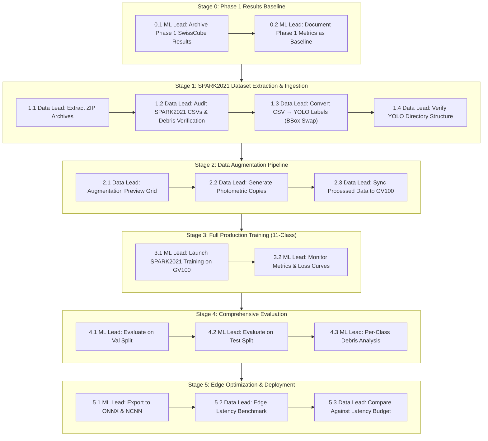

# Space Debris Detection System — Operational Workflow Playbook

> **Dataset Revision Notice (Phase 2):**
> This playbook supersedes the Phase 1 version which was built around the original SPARK dataset (10 spacecraft classes, **zero debris annotations**). The project has transitioned to **SPARK2021** (SPAcecraft Recognition leveraging Knowledge of space environment, ICIP 2021 Challenge), which provides **11 classes** — 10 satellite models + 1 consolidated Debris class (~25,000 debris images across 5 debris sub-models) — directly addressing the project's core objective of space debris detection.

---

## Team Roles & Hardware Matrix

| Role | Primary Responsibilities | Target Hardware | Working Directory |
|---|---|---|---|
| **ML Lead** (Role 1) | Model architecture, GPU training loops, hyperparameter tuning, model checkpoints (`best.pt`), full-set mAP evaluation, ONNX export | **Workstation**: NVIDIA Quadro GV100 (32 GB VRAM) | `D:\SPACE_DEBRIS\space-debris-detection-system` |
| **Data & Edge Lead** (Role 2) | Data ingestion, ZIP extraction, CSV→YOLO conversion, dataset splitting, class auditing, photometric augmentation, edge env health, ONNX/NCNN latency benchmarks | **Local Laptop / Edge Testbed**: Intel Core i5 + NVIDIA RTX 2050 / Raspberry Pi 4/5 | `C:\Users\...\space-debris-detection-system` |

---

## Dataset Comparison: Why SPARK2021 Replaces Old SPARK

| Aspect | Old SPARK (Phase 1) | SPARK2021 (Phase 2+) |
|---|---|---|
| **Total Classes** | 10 (spacecraft only) | **11** (10 satellites + 1 Debris) |
| **Debris Annotations** | ❌ Zero | ✅ ~25,000 images (5 debris sub-models merged) |
| **Total Images** | ~80,000 | **~150,000** (90k train / 30k validate / 30k test) |
| **Pre-split Test Set** | ❌ None (manual 80/15/5 split needed) | ✅ Provided (`test_labels.csv`, 30k images) |
| **Depth Maps** | ❌ None | ✅ Paired 16-bit PNG depth per RGB |
| **Illumination Metadata** | ❌ None | ✅ Per-image illumination value |
| **BBox Convention** | Standard | Row/Column: `[R_min, C_min, R_max, C_max]` |
| **CSV Columns** | `Image name, Class` | `class, id, image, depth, bbox, illumination` |
| **Class Names** | Cheops, LisaPathfinder, Proba2, etc. | AcrimSat, Aquarius, Aura, Calipso, Cloudsat, CubeSat, Debris, Jason, Sentinel-6, Terra, TRMM |

> **Key Implication:** DEC-04 from Phase 1 (which locked the project to "Branch B — 10-class spacecraft detection") is now **superseded**. SPARK2021's Debris class enables the project to pursue its original intent: satellite *and* debris detection.

---

## Master Ordinal Pipeline Overview



---

## Stage 0: Phase 1 Baseline Archival

### Step 0.1: Archive Phase 1 SwissCube Results
- **Assigned Role**: **ML Lead**
- **Machine**: Any
- **Action**: Ensure Phase 1 artifacts are preserved for comparison:
  - `experiments/week1_smoke_test/weights/best.pt` and `last.pt`
  - `docs/Phase_1_Comprehensive_Engineering_Report.pdf`
  - `edge_benchmark.json`
  - `docs/spark_class_audit.json`
- **Exit Criteria**:
  - Phase 1 experiment directory intact under `experiments/week1_smoke_test/`.
  - All evaluation JSONs archived under `outputs/evaluations/`.

### Step 0.2: Document Phase 1 Baseline Metrics
- **Assigned Role**: **ML Lead**
- **Action**: Record Phase 1 metrics for regression comparison:
  - **Phase 1 Dataset**: SwissCube (single-class, 17,289 train / 3,242 val images)
  - **mAP@0.5**: `0.9903` (5 epochs, 1024px)
  - **mAP@0.5:0.95**: `0.9211`
  - **Edge Latency**: ONNX 4-thread = `85.94 ms` mean (i5 CPU proxy)
  - **Limitation**: Zero debris detection capability — strictly satellite-only.

---

## Stage 1: SPARK2021 Dataset Extraction & Ingestion

### Step 1.1: Extract SPARK2021 ZIP Archives
- **Assigned Role**: **Data & Edge Lead**
- **Machine**: Machine with sufficient disk space (~20 GB for extracted images)
- **Prerequisite**: SPARK2021 downloaded to `data/raw/SPARK2021/` containing:
  - `train_rgb.zip` (~4.8 GB), `train_labels.csv` (90,000 rows)
  - `validate_rgb.zip` (~1.5 GB), `validate_labels.csv` (30,000 rows)
  - `test_rgb.zip` (~1.6 GB), `test_labels.csv` (30,000 rows)
  - *(Optional)* `train_depth.zip`, `validate_depth.zip`, `test_depth.zip`
- **Commands**:
  ```powershell
  # Extract RGB images (depth extraction is optional — not needed for YOLO training)
  Expand-Archive -Path data/raw/SPARK2021/train_rgb.zip -DestinationPath data/raw/SPARK2021/train_rgb/ -Force
  Expand-Archive -Path data/raw/SPARK2021/validate_rgb.zip -DestinationPath data/raw/SPARK2021/validate_rgb/ -Force
  Expand-Archive -Path data/raw/SPARK2021/test_rgb.zip -DestinationPath data/raw/SPARK2021/test_rgb/ -Force
  ```
- **Exit Criteria**:
  - `data/raw/SPARK2021/train_rgb/` contains ~90,000 PNG images.
  - `data/raw/SPARK2021/validate_rgb/` contains ~30,000 PNG images.
  - `data/raw/SPARK2021/test_rgb/` contains ~30,000 PNG images.

### Step 1.2: Audit SPARK2021 Annotations & Verify Debris Class
- **Assigned Role**: **Data & Edge Lead**
- **Machine**: Any
- **Command**:
  ```powershell
  python scripts/audit_spark2021_annotations.py --spark-dir data/raw/SPARK2021
  ```
  *(Note: A new audit script adapted for SPARK2021's CSV schema — columns: `class, id, image, depth, bbox, illumination` for train/validate; `id, image, depth, class, bbox` for test.)*
- **Exit Criteria**:
  - Terminal displays class frequency table across all 11 classes.
  - **Confirms Debris class IS present** (supersedes DEC-04 / Branch B from Phase 1).
  - Expected distribution: ~12,500 images per satellite class, ~25,000 for Debris (across 5 sub-models).
  - Output saved to `docs/spark2021_class_audit.json`.

### Step 1.3: Convert SPARK2021 CSV Annotations → YOLO Format
- **Assigned Role**: **Data & Edge Lead**
- **Machine**: Any
- **Prerequisite**: Step 1.1 (extraction) and Step 1.2 (audit) complete.
- **Command**:
  ```powershell
  python scripts/convert_spark2021_to_yolo.py `
    --spark-dir data/raw/SPARK2021 `
    --out data/processed/spark2021 `
    --imgsz 1024
  ```
- **Critical Implementation Notes**:
  - **BBox Convention Swap**: SPARK2021 uses row/column ordering `[R_min, C_min, R_max, C_max]` which equals `[y_min, x_min, y_max, x_max]`. The conversion script MUST swap to YOLO's `<x_center> <y_center> <width> <height>` (normalized 0.0–1.0):
    ```python
    r_min, c_min, r_max, c_max = bbox   # SPARK2021 convention
    # YOLO normalized (cx, cy, w, h) for image of size (H, W)
    cx = ((c_min + c_max) / 2) / W
    cy = ((r_min + r_max) / 2) / H
    w  = (c_max - c_min) / W
    h  = (r_max - r_min) / H
    ```
  - **Class ID Mapping** (alphabetical by SPARK2021 convention):
    ```
    0: AcrimSat    (Satellite)
    1: Aquarius    (Satellite)
    2: Aura        (Satellite)
    3: Calipso     (Satellite)
    4: Cloudsat    (Satellite)
    5: CubeSat     (Satellite)
    6: Debris      (Debris — 5 sub-models merged)
    7: Jason       (Satellite)
    8: Sentinel-6  (Satellite)
    9: Terra       (Satellite)
   10: TRMM        (Satellite)
    ```
  - SPARK2021 already provides train/validate/test splits. Use them as-is (do NOT re-split).
- **Exit Criteria**:
  - `data/processed/spark2021/` created with structure:
    ```text
    data/processed/spark2021/
    ├── images/
    │   ├── train/      (~90,000 images)
    │   ├── val/        (~30,000 images — renamed from "validate")
    │   └── test/       (~30,000 images)
    └── labels/
        ├── train/
        ├── val/
        └── test/
    ```
  - Label text files have format: `<class_id> <x_center> <y_center> <width> <height>` (normalized 0.0–1.0).
  - Spot-check: visually verify ≥5 random images with overlaid bounding boxes to confirm coordinate accuracy after the row/column swap.

### Step 1.4: Verify SPARK2021 YOLO Configuration
- **Assigned Role**: **Data & Edge Lead**
- **File**: `configs/spark2021.yaml`
- **Verification**: Create and verify `configs/spark2021.yaml`:
  ```yaml
  # SPARK2021 11-Class Dataset Configuration (Satellites + Debris)
  path: ./data/processed/spark2021
  train: images/train
  val: images/val
  test: images/test

  names:
    0: AcrimSat
    1: Aquarius
    2: Aura
    3: Calipso
    4: Cloudsat
    5: CubeSat
    6: Debris
    7: Jason
    8: Sentinel-6
    9: Terra
    10: TRMM
  ```
- **Exit Criteria**:
  - `configs/spark2021.yaml` exists with correct paths and all 11 class names.
  - Running `yolo val model=yolov8n.pt data=configs/spark2021.yaml` does not raise path-resolution errors (images found, even if untrained model yields near-zero mAP).

---

## Stage 2: Photometric Augmentation Pipeline

### Step 2.1: Generate Augmentation Sanity Check (Preview Only)
- **Assigned Role**: **Data & Edge Lead**
- **Machine**: Laptop or Workstation
- **Command**:
  ```powershell
  python src/data/augment.py --data data/processed/spark2021 --preview-only
  ```
- **Exit Criteria**:
  - Generates preview grid image showing original vs. augmented samples (blur, noise, exposure jitter).
  - Inspect visually: ensure Debris class objects (often small, low-contrast fragments) remain visible after augmentation.
  - Bounding box validity is preserved (photometric-only transforms don't alter coordinates).

### Step 2.2: Generate Offline Training Augmentations (Optional or via train.py)
- **Assigned Role**: **Data & Edge Lead**
- **Command**:
  ```powershell
  python src/data/augment.py --data data/processed/spark2021 --copies 1
  ```
  *(Note: Alternatively, `src/train.py` will auto-run this if `--augment-copies 1` is passed).*
- **Exit Criteria**:
  - `data/processed/spark2021/images/train/` contains `aug1_*` images with corresponding label duplicates in `labels/train/`.
  - **Important**: With ~90k training images, offline augmentation will require significant disk space. Consider using `--augment-copies 0` and relying on YOLOv8's on-the-fly augmentations for Phase 2 to save time/disk.

### Step 2.3: Data Sync to Workstation
- **Assigned Role**: **Data & Edge Lead**
- **Action**: Since `data/` is in `.gitignore`, transfer `data/processed/spark2021` directly to the workstation drive:
  `D:\SPACE_DEBRIS\space-debris-detection-system\data\processed\spark2021`.

---

## Stage 3: Full Production Model Training (SPARK2021 11-Class)

### Step 3.1: Launch GPU Training on GV100
- **Assigned Role**: **ML Lead**
- **Machine**: Workstation (NVIDIA Quadro GV100, 32 GB VRAM)
- **Prerequisite**: `data/processed/spark2021` present; `configs/spark2021.yaml` verified.
- **Command**:
  ```powershell
  python src/train.py `
    --epochs 50 `
    --imgsz 1024 `
    --batch 16 `
    --augment-copies 0 `
    --name spark2021_yolov8n_50e `
    --data-config configs/spark2021.yaml `
    --device 0
  ```
- **Training Considerations for SPARK2021**:
  - **Dataset Size**: ~90k training images (vs ~60k in old SPARK). Training time will increase proportionally (~1.5x per epoch). Budget ~12–15 hours for 50 epochs at batch 16, 1024px on GV100.
  - **Class Imbalance**: Debris has ~25k images vs ~12.5k per satellite class. Consider adding `--cls-weight` or focal loss configuration in a follow-up run if Debris recall is low.
  - **On-the-fly Augmentations**: `--augment-copies 0` recommended here — rely on YOLOv8's built-in space-domain augmentations (rotation, flip, HSV jitter, erasing) configured in `train.py`.

### Step 3.2: Monitor Convergence & Archival
- **Assigned Role**: **ML Lead**
- **Exit Criteria**:
  - Training completes all 50 epochs without CUDA OOM (GV100 32 GB easily fits batch 16 at 1024x1024).
  - Weights saved: `experiments/spark2021_yolov8n_50e/weights/best.pt` and `last.pt`.
  - Archival log updated: `outputs/training/latest.json`.
  - **Key metrics to watch**: Per-class AP for `Debris` — this is the primary new capability over Phase 1.

---

## Stage 4: Comprehensive Model Evaluation (EVAL-02 Schema)

### Step 4.1: Validation Split Evaluation
- **Assigned Role**: **ML Lead**
- **Machine**: Workstation (Quadro GV100)
- **Command**:
  ```powershell
  python src/eval.py `
    --weights experiments/spark2021_yolov8n_50e/weights/best.pt `
    --data configs/spark2021.yaml `
    --split val `
    --imgsz 1024 `
    --batch 16 `
    --device 0 `
    --out-json outputs/evaluations/spark2021_val_metrics.json
  ```

### Step 4.2: Hold-Out Test Split Evaluation (Final Benchmark)
- **Assigned Role**: **ML Lead**
- **Machine**: Workstation (Quadro GV100)
- **Command**:
  ```powershell
  python src/eval.py `
    --weights experiments/spark2021_yolov8n_50e/weights/best.pt `
    --data configs/spark2021.yaml `
    --split test `
    --imgsz 1024 `
    --batch 16 `
    --device 0 `
    --out-json outputs/evaluations/spark2021_test_metrics.json
  ```
- **Exit Criteria**:
  - Target metrics logged:
    - Overall mAP@50 $\ge 80\%$
    - Overall mAP@50-95 $\ge 55\%$
    - **Debris class AP@50 $\ge 70\%$** (critical: this validates the dataset transition rationale)
    - Class-by-class breakdown saved in `outputs/evaluations/spark2021_test_metrics.json`.

### Step 4.3: Debris-Focused Analysis
- **Assigned Role**: **ML Lead**
- **Action**: Extract and document Debris-specific metrics from eval results:
  - Debris Precision, Recall, AP@50, AP@50-95
  - Confusion matrix: Debris ↔ satellite misclassification rate (aligned with SPARK2021 ICIP challenge Task 1 severity weighting)
  - Compare overall mAP against Phase 1 baseline (single-class SwissCube: mAP@50 = 0.9903) — expect lower mAP due to 11-class complexity and debris difficulty.
- **Exit Criteria**:
  - Debris-specific metrics documented in `outputs/evaluations/spark2021_debris_analysis.json`.
  - Written comparison against Phase 1 baseline metrics archived.

---

## Stage 5: Edge Optimization & Real-Time Benchmarking

### Step 5.1: Multi-Format Model Export
- **Assigned Role**: **ML Lead**
- **Machine**: Workstation
- **Commands**:
  ```powershell
  # 1. Export ONNX (FP32, simplified graph)
  yolo export model=experiments/spark2021_yolov8n_50e/weights/best.pt format=onnx imgsz=1024 simplify=True

  # 2. Export NCNN for ARM CPU / Raspberry Pi acceleration
  yolo export model=experiments/spark2021_yolov8n_50e/weights/best.pt format=ncnn imgsz=1024
  ```
- **Exit Criteria**:
  - `experiments/spark2021_yolov8n_50e/weights/best.onnx` generated.
  - `experiments/spark2021_yolov8n_50e/weights/best_ncnn_model/` generated (`model.bin`, `model.param`).
  - **Note**: The 11-class output head is slightly larger than Phase 1's 1-class or 10-class heads. Model size increase should be negligible (<100 KB).

### Step 5.2: Edge Hardware Latency & RSS Benchmark
- **Assigned Role**: **Data & Edge Lead**
- **Machine**: Local Laptop / Raspberry Pi Testbed
- **Prerequisite**: Copy exported ONNX and NCNN weights to edge testbed.
- **Commands**:
  ```powershell
  # Verify testbed environment first
  python edge/verify_pi_env.py

  # Benchmark ONNX model (10 warmup, 100 timed runs, 4 CPU threads)
  python edge/benchmark.py `
    --model experiments/spark2021_yolov8n_50e/weights/best.onnx `
    --imgsz 1024 `
    --device cpu `
    --threads 4 `
    --runs 100 `
    --warmup 10 `
    --out-json outputs/benchmarks/spark2021_onnx_benchmark.json
  ```
- **Exit Criteria**:
  - Target latency budget: $\le 100\text{ ms}$ (throughput $\ge 10\text{ FPS}$).
  - Peak memory footprint: $\le 512\text{ MB RAM}$.
  - Results archived to `outputs/benchmarks/spark2021_onnx_benchmark.json`.
  - **Comparison**: Latency should be comparable to Phase 1 (85.94 ms ONNX 4-thread on i5) since model architecture is identical (YOLOv8n); only the classification head changes from 10→11 classes.

---

## Quick Reference Summary Table

| Step | Script / Tool | Primary Role | Hardware Target | Expected Output Artifact |
|---|---|---|---|---|
| **0.1** | Manual archival | ML Lead | Any | Phase 1 artifacts preserved |
| **0.2** | Documentation | ML Lead | Any | Phase 1 baseline metrics recorded |
| **1.1** | `Expand-Archive` | Data Lead | Any | Extracted RGB images (~150k) |
| **1.2** | `scripts/audit_spark2021_annotations.py` | Data Lead | Any | `docs/spark2021_class_audit.json` |
| **1.3** | `scripts/convert_spark2021_to_yolo.py` | Data Lead | Any | `data/processed/spark2021/{images,labels}` |
| **1.4** | Manual verification | Data Lead | Any | `configs/spark2021.yaml` |
| **2.1** | `src/data/augment.py` | Data Lead | Any | Preview grid check |
| **2.2** | `src/data/augment.py` | Data Lead | Any | Augmented training images |
| **2.3** | Manual sync | Data Lead | Any | Data on GV100 |
| **3.1** | `src/train.py` | ML Lead | Quadro GV100 | `experiments/spark2021_yolov8n_50e/weights/best.pt` |
| **3.2** | Monitoring | ML Lead | Quadro GV100 | `outputs/training/latest.json` |
| **4.1** | `src/eval.py` | ML Lead | Quadro GV100 | `outputs/evaluations/spark2021_val_metrics.json` |
| **4.2** | `src/eval.py` | ML Lead | Quadro GV100 | `outputs/evaluations/spark2021_test_metrics.json` |
| **4.3** | Analysis | ML Lead | Any | `outputs/evaluations/spark2021_debris_analysis.json` |
| **5.1** | `yolo export` | ML Lead | Quadro GV100 | `best.onnx` and `best_ncnn_model/` |
| **5.2** | `edge/benchmark.py` | Data Lead | Edge / Laptop | `outputs/benchmarks/spark2021_onnx_benchmark.json` |

---

## Appendix: Phase 1 Results Summary (SwissCube / Old SPARK Baseline)

Preserved for regression comparison. Phase 1 used the original SPARK dataset (10 spacecraft classes, zero debris) and SwissCube (single satellite class).

| Metric | Phase 1 Value | Notes |
|---|---|---|
| **Dataset** | SwissCube (17,289 train, 3,242 val) | Single-class satellite detection |
| **mAP@0.5** | 0.9903 | 5 epochs, 1024px, YOLOv8n |
| **mAP@0.5:0.95** | 0.9211 | |
| **Precision** | 0.974 | |
| **Recall** | 0.962 | |
| **ONNX Latency (4-thread, i5 CPU)** | 85.94 ms mean, 97.62 ms p95 | 11.6 FPS |
| **NCNN Latency (4-thread)** | 165.21 ms mean, 178.48 ms p95 | 6.1 FPS (from earlier benchmark) |
| **Debris Detection** | ❌ Not possible | Old SPARK had 0 debris annotations |

### Key Phase 1 Findings (DEC-04)
- Row-by-row audit of old SPARK confirmed **zero debris rows** in all 80,000 annotations.
- The original SPARK was a pure 10-class spacecraft recognition dataset (Cheops, LisaPathfinder, Proba2, etc.).
- This forced adoption of "Branch B" — qualitative-only debris coverage.
- **Resolution**: SPARK2021 directly resolves this gap by including a consolidated Debris class with ~25,000 annotated images across 5 debris sub-models.

### Superclass Taxonomy Update

| Our Superclass | Old SPARK (Phase 1) | SPARK2021 (Phase 2+) |
|---|---|---|
| `satellite` | ✅ All 10 classes → superclass | ✅ 10 satellite classes available |
| `debris` | ❌ Absent | ✅ `Debris` class (5 sub-models merged) |
| `rocket_body` | ❌ Absent | ❌ Still absent — defer to stretch goal |
