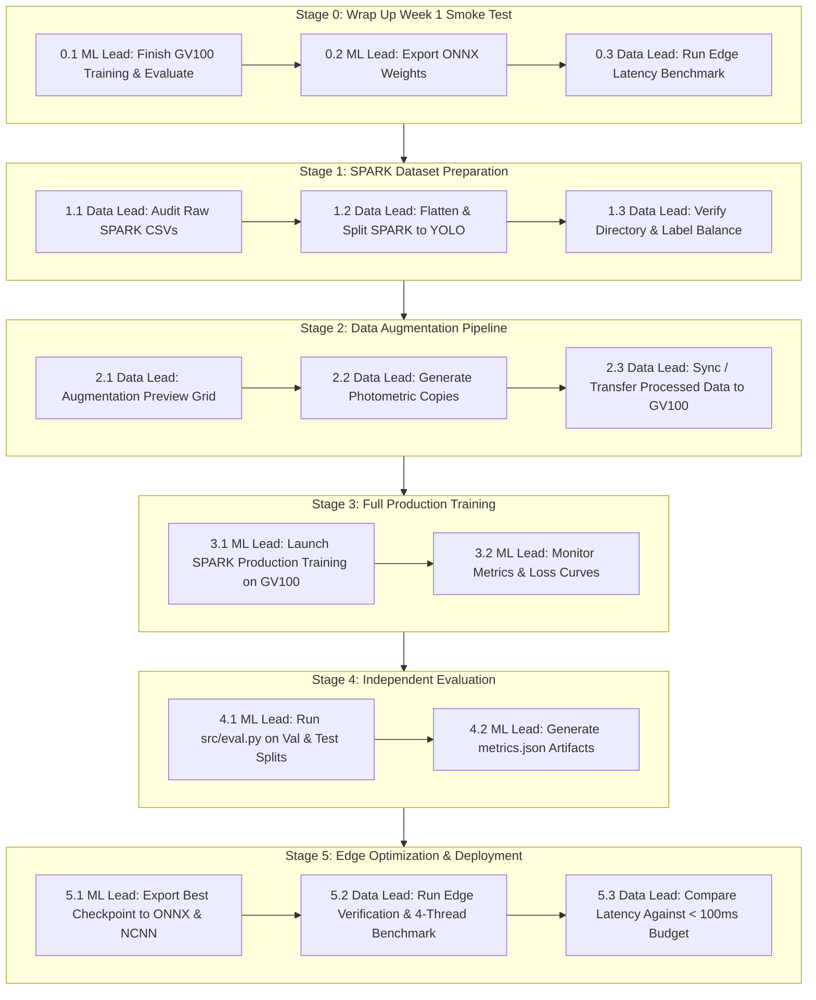

# Space Debris Detection System — Operational Workflow Playbook

This document defines the strict, ordinal end-to-end execution pipeline for the **ML Lead** and the **Data & Edge Lead**. Every step specifies its prerequisites, assigned role, compute target, exact command line, and verification exit criteria.

---

## Team Roles & Hardware Matrix

| Role | Primary Responsibilities | Target Hardware | Working Directory |
|---|---|---|---|
| **ML Lead** (Role 1) | Model architecture, GPU training loops, hyperparameter tuning, model checkpoints (`best.pt`), full-set mAP evaluation, ONNX export | **Workstation**: NVIDIA Quadro GV100 (32 GB VRAM) | `D:\SPACE_DEBRIS\space-debris-detection-system` |
| **Data & Edge Lead** (Role 2) | Data ingestion, conversion, dataset splitting, class auditing, photometric augmentation, edge env health, ONNX/NCNN latency benchmarks | **Local Laptop / Edge Testbed**: Intel Core i5 + NVIDIA RTX 2050 / Raspberry Pi 4/5 | `C:\Users\...\space-debris-detection-system` |

---

## Master Ordinal Pipeline Overview



---

## Stage 0: Week-1 Smoke Test Wrap-up (Immediate Action)

### Step 0.1: Validate Smoke Test & Run Evaluation
- **Assigned Role**: **ML Lead**
- **Machine**: Workstation (NVIDIA Quadro GV100)
- **Prerequisite**: Current training run `experiments/week1_smoke_test` completes epoch 5.
- **Command**:
  ```powershell
  python src/eval.py --weights experiments/week1_smoke_test/weights/best.pt --data configs/swisscube.yaml --split val --device 0 --out-json outputs/evaluations/week1_smoke_eval.json
  ```
- **Exit Criteria**:
  - `outputs/evaluations/week1_smoke_eval.json` created.
  - mAP50 and mAP50-95 scores printed to terminal.

### Step 0.2: Export Smoke Test Checkpoint to ONNX
- **Assigned Role**: **ML Lead**
- **Machine**: Workstation (Quadro GV100)
- **Command**:
  ```powershell
  yolo export model=experiments/week1_smoke_test/weights/best.pt format=onnx imgsz=1024 simplify=True
  ```
- **Exit Criteria**:
  - `experiments/week1_smoke_test/weights/best.onnx` generated (~12 MB).

### Step 0.3: Edge Latency Benchmark
- **Assigned Role**: **Data & Edge Lead**
- **Machine**: Local Laptop / Edge Testbed
- **Prerequisite**: Pull `best.onnx` or copy from workstation.
- **Command**:
  ```powershell
  python edge/benchmark.py --model experiments/week1_smoke_test/weights/best.onnx --imgsz 1024 --device cpu --threads 4
  ```
- **Exit Criteria**:
  - `outputs/benchmarks/latest.json` updated with p50/p90/p95 latency and FPS.

---

## Stage 1: SPARK Dataset Ingestion & Splitting

### Step 1.1: Audit Raw SPARK Annotations (DEC-04)
- **Assigned Role**: **Data & Edge Lead**
- **Machine**: Where raw SPARK is stored (Laptop or Workstation)
- **Prerequisite**: Raw SPARK folder downloaded (containing `train/` and `val/` with images and CSVs).
- **Command**:
  ```powershell
  python scripts/audit_spark_annotations.py --spark-dir D:/SPACE_DEBRIS/datasets/spark
  ```
- **Exit Criteria**:
  - Terminal displays class frequency table across all 10 spacecraft classes.
  - Confirms zero bounding boxes under generic `debris` class (locking DEC-04).

### Step 1.2: Convert & Split SPARK into YOLO Format
- **Assigned Role**: **Data & Edge Lead**
- **Machine**: Machine where raw SPARK resides
- **Command**:
  ```powershell
  python src/data/split_dataset.py --data D:/SPACE_DEBRIS/datasets/spark --out data/processed/spark --split 0.80 0.15 0.05
  ```
- **Exit Criteria**:
  - `data/processed/spark/` created with structure:
    ```text
    data/processed/spark/
    ├── images/
    │   ├── train/ (80%)
    │   ├── val/   (15%)
    │   └── test/  (5%)
    └── labels/
        ├── train/
        ├── val/
        └── test/
    ```
  - Label text files have format: `<class_id> <x_center> <y_center> <width> <height>` (normalized 0.0–1.0).

### Step 1.3: Verify SPARK YOLO Configuration
- **Assigned Role**: **Data & Edge Lead**
- **File**: `configs/spark.yaml`
- **Verification**: Ensure `configs/spark.yaml` matches the converted directory:
  ```yaml
  path: ../data/processed/spark
  train: images/train
  val: images/val
  test: images/test

  names:
    0: Cheops
    1: LisaPathfinder
    2: ObservationSat1
    3: Proba2
    4: Proba3
    5: Proba3ocs
    6: Smart1
    7: Soho
    8: VenusExpress
    9: XMM Newton
  ```

---

## Stage 2: Photometric Augmentation Pipeline

### Step 2.1: Generate Augmentation Sanity Check (Preview Only)
- **Assigned Role**: **Data & Edge Lead**
- **Machine**: Laptop or Workstation
- **Command**:
  ```powershell
  python src/data/augment.py --data data/processed/spark --preview-only
  ```
- **Exit Criteria**:
  - Generates preview grid image showing original vs. augmented samples (blur, noise, exposure jitter).
  - Inspect visually to ensure objects remain visible and bounding box validity is preserved.

### Step 2.2: Generate Offline Training Augmentations (Optional or via train.py)
- **Assigned Role**: **Data & Edge Lead**
- **Command**:
  ```powershell
  python src/data/augment.py --data data/processed/spark --copies 1
  ```
  *(Note: Alternatively, `src/train.py` will auto-run this if `--augment-copies 1` is passed).*
- **Exit Criteria**:
  - `data/processed/spark/images/train/` contains `aug1_*` images with corresponding label duplicates in `labels/train/`.

### Step 2.3: Data Sync to Workstation
- **Assigned Role**: **Data & Edge Lead**
- **Action**: Since `data/` is in `.gitignore`, transfer `data/processed/spark` directly to the workstation drive:
  `D:\SPACE_DEBRIS\space-debris-detection-system\data\processed\spark`.

---

## Stage 3: Full Production Model Training (SPARK 10-Class)

### Step 3.1: Launch GPU Training on GV100
- **Assigned Role**: **ML Lead**
- **Machine**: Workstation (NVIDIA Quadro GV100, 32 GB VRAM)
- **Prerequisite**: `data/processed/spark` present; `configs/spark.yaml` verified.
- **Command**:
  ```powershell
  python src/train.py `
    --epochs 50 `
    --imgsz 1024 `
    --batch 16 `
    --augment-copies 0 `
    --name spark_yolov8n_50e `
    --data-config configs/spark.yaml `
    --device 0
  ```
  *(Note: `--augment-copies 0` is recommended here if Step 2.2 was already run, or if space-domain on-the-fly augmentations are sufficient).*

### Step 3.2: Monitor Convergence & Archival
- **Assigned Role**: **ML Lead**
- **Exit Criteria**:
  - Training completes all epochs without CUDA OOM (GV100 32 GB easily fits batch 16 at 1024x1024).
  - Weights saved: `experiments/spark_yolov8n_50e/weights/best.pt` and `last.pt`.
  - Archival log updated: `outputs/training/latest.json`.

---

## Stage 4: Comprehensive Model Evaluation (EVAL-02 Schema)

### Step 4.1: Validation Split Evaluation
- **Assigned Role**: **ML Lead**
- **Machine**: Workstation (Quadro GV100)
- **Command**:
  ```powershell
  python src/eval.py `
    --weights experiments/spark_yolov8n_50e/weights/best.pt `
    --data configs/spark.yaml `
    --split val `
    --imgsz 1024 `
    --batch 16 `
    --device 0 `
    --out-json outputs/evaluations/spark_val_metrics.json
  ```

### Step 4.2: Hold-Out Test Split Evaluation (Final Benchmark)
- **Assigned Role**: **ML Lead**
- **Machine**: Workstation (Quadro GV100)
- **Command**:
  ```powershell
  python src/eval.py `
    --weights experiments/spark_yolov8n_50e/weights/best.pt `
    --data configs/spark.yaml `
    --split test `
    --imgsz 1024 `
    --batch 16 `
    --device 0 `
    --out-json outputs/evaluations/spark_test_metrics.json
  ```
- **Exit Criteria**:
  - Target metrics logged:
    - Overall mAP@50 $\ge 85\%$
    - Overall mAP@50-95 $\ge 60\%$
    - Class-by-class breakdown saved in `outputs/evaluations/spark_test_metrics.json`.

---

## Stage 5: Edge Optimization & Real-Time Benchmarking

### Step 5.1: Multi-Format Model Export
- **Assigned Role**: **ML Lead**
- **Machine**: Workstation
- **Commands**:
  ```powershell
  # 1. Export ONNX (half precision and simplified)
  yolo export model=experiments/spark_yolov8n_50e/weights/best.pt format=onnx imgsz=1024 simplify=True

  # 2. Export NCNN for ARM CPU / Raspberry Pi acceleration
  yolo export model=experiments/spark_yolov8n_50e/weights/best.pt format=ncnn imgsz=1024
  ```
- **Exit Criteria**:
  - `experiments/spark_yolov8n_50e/weights/best.onnx` generated.
  - `experiments/spark_yolov8n_50e/weights/best_ncnn_model/` generated (`model.bin`, `model.param`).

### Step 5.2: Edge Hardware Latency & RSS Benchmark
- **Assigned Role**: **Data & Edge Lead**
- **Machine**: Local Laptop / Raspberry Pi Testbed
- **Prerequisite**: Copy exported ONNX and NCNN weights to edge testbed.
- **Commands**:
  ```powershell
  # Verify testbed environment first
  python edge/verify_pi_env.py

  # Benchmark ONNX model (10 warmup, 100 timed runs, 4 CPU threads)
  python edge/benchmark.py `
    --model experiments/spark_yolov8n_50e/weights/best.onnx `
    --imgsz 1024 `
    --device cpu `
    --threads 4 `
    --runs 100 `
    --warmup 10 `
    --out-json outputs/benchmarks/spark_onnx_benchmark.json
  ```
- **Exit Criteria**:
  - Target latency budget: $\le 100\text{ ms}$ (throughput $\ge 10\text{ FPS}$).
  - Peak memory footprint: $\le 512\text{ MB RAM}$.
  - Results archived to `outputs/benchmarks/spark_onnx_benchmark.json`.

---

## Quick Reference Summary Table

| Step | Script | Primary Role | Hardware Target | Expected Output Artifact |
|---|---|---|---|---|
| **0.1** | `src/eval.py` | ML Lead | Quadro GV100 | `outputs/evaluations/week1_smoke_eval.json` |
| **0.2** | `yolo export` | ML Lead | Quadro GV100 | `experiments/week1_smoke_test/weights/best.onnx` |
| **0.3** | `edge/benchmark.py` | Data Lead | Edge / Laptop | `outputs/benchmarks/latest.json` |
| **1.1** | `scripts/audit_spark_annotations.py` | Data Lead | Any | Terminal Audit & DEC-04 confirmation |
| **1.2** | `src/data/split_dataset.py` | Data Lead | Any | `data/processed/spark/{images,labels}` |
| **2.1** | `src/data/augment.py` | Data Lead | Any | Preview grid check |
| **3.1** | `src/train.py` | ML Lead | Quadro GV100 | `experiments/spark_yolov8n_50e/weights/best.pt` |
| **4.1** | `src/eval.py` | ML Lead | Quadro GV100 | `outputs/evaluations/spark_val_metrics.json` |
| **4.2** | `src/eval.py` | ML Lead | Quadro GV100 | `outputs/evaluations/spark_test_metrics.json` |
| **5.1** | `yolo export` | ML Lead | Quadro GV100 | `best.onnx` and `best_ncnn_model/` |
| **5.2** | `edge/benchmark.py` | Data Lead | Edge / Laptop | `outputs/benchmarks/spark_onnx_benchmark.json` |
