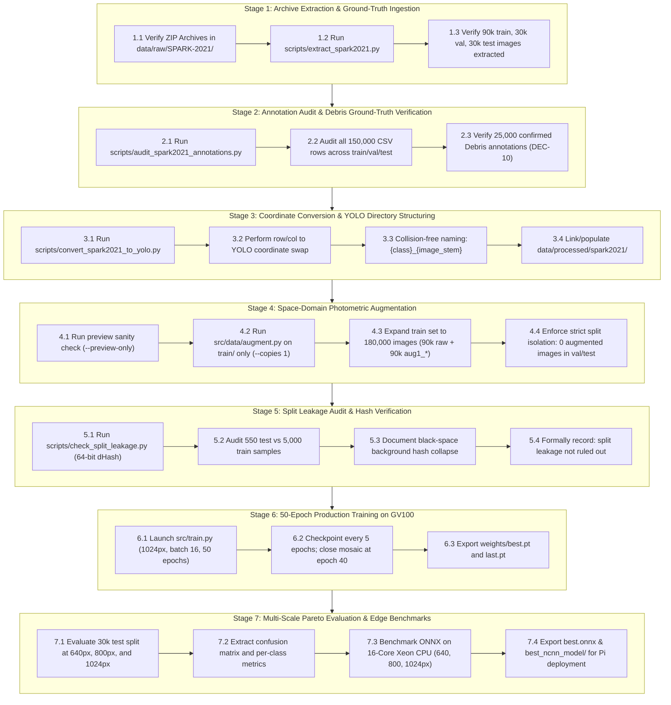

# SPARK-2021 Phase 2 Operational Workflow Playbook
## High-Performance Execution Guide for NVIDIA Quadro GV100 Workstation

**Project:** ISRO Hardware & Edge Vision Challenge (Problem Statement #05)  
**Phase:** 02 — SPARK Dataset Preparation & Stratified Subsetting  
**Target Hardware:** NVIDIA Quadro GV100 (32 GB VRAM) + 16-Core Intel Xeon CPU  
**Workstation Base Path:** `D:\SharanyaTIlak_Spoorthy_Indu\space-debris-detection-system`  
**Dataset:** Official SPARK-2021 (150,000 raw images, 11 classes, ~25,000 synthetic debris annotations)  
**Date:** October 19, 2026  
**Status:** **Active Phase 2 Execution Guide**

---

## 1. System Architecture & Workstation Profile

All commands in this playbook are designed to execute on the **NVIDIA Quadro GV100 Workstation**. The local development laptop is used only for repository git synchronization, code editing, and offline documentation review.

| System Dimension | Workstation Specification | Operational Role in Phase 2 |
|---|---|---|
| **GPU Accelerator** | **NVIDIA Quadro GV100 (32 GB HBM2 VRAM)** | High-throughput batch inference, 50-epoch deep training (batch size 16 at 1024x1024 px) |
| **CPU Platform** | **Intel Xeon (Family 6 Model 85, 16 Cores / 32 Threads)** | Multi-threaded extraction, dataset formatting, and multi-thread ONNX proxy benchmarking |
| **System Memory** | **64 GB DDR4 ECC RAM** | In-memory dataset caching, difference hash matrix computing |
| **Storage Architecture** | **High-Speed NVMe / Local Drive `D:`** | Fast random I/O for 150,000 raw + 90,000 augmented space images |
| **Operating System** | **Windows 10/11 Pro (AMD64)** | Native PowerShell 5.1 / 7+ and CMD terminal execution |
| **Python Environment** | **Python 3.11.9 (CUDA 12.x / PyTorch 2.x cuDNN)** | Core runtime for Ultralytics YOLOv8, Albumentations, Skyfield, OpenCV |

---

## 2. End-to-End Master Pipeline (Mermaid)



---

## 3. Detailed Execution Stages (GV100 Terminal Protocols)

### STAGE 1: Archive Extraction & Ground-Truth Ingestion

**Objective:** Safely unpack the compressed SPARK-2021 raw archives without corrupting folder hierarchies or consuming redundant disk storage.

- **Working Directory:** `D:\SharanyaTIlak_Spoorthy_Indu\space-debris-detection-system`
- **Raw Data Directory:** `data\raw\SPARK-2021`
- **Archives Required:**
  - `train_rgb.zip` (~4.8 GB, contains 90,000 training images nested by class)
  - `validate_rgb.zip` (~1.5 GB, contains 30,000 validation images nested by class)
  - `test_rgb.zip` (~1.6 GB, contains 30,000 test images nested by class)
  - `train_labels.csv`, `validate_labels.csv`, `test_labels.csv`

#### Command Execution (GV100 Workstation):
```powershell
# Navigate to repository root
cd D:\SharanyaTIlak_Spoorthy_Indu\space-debris-detection-system

# Verify raw files exist
Get-ChildItem -Path "data\raw\SPARK-2021"

# Run automated extraction utility with auto-detection and progress logging every 5,000 files
python scripts/extract_spark2021.py --spark-dir data/raw/SPARK-2021 --split all
```

#### Exit Verification Gate:
```powershell
# Verify image counts
(Get-ChildItem -Path "data\raw\SPARK-2021\train_rgb" -Recurse -Filter "*.jpg").Count    # Must be 90,000
(Get-ChildItem -Path "data\raw\SPARK-2021\validate_rgb" -Recurse -Filter "*.jpg").Count # Must be 30,000
(Get-ChildItem -Path "data\raw\SPARK-2021\test_rgb" -Recurse -Filter "*.jpg").Count     # Must be 30,000
```
- **Pass Criteria:** Exactly 150,000 raw image files unpacked across `train_rgb`, `validate_rgb`, and `test_rgb`.

---

### STAGE 2: Annotation Audit & Debris Verification

**Objective:** Inspect all 150,000 annotation rows to confirm the presence of 25,000 ground-truth debris annotations, validate bounding box ranges, and establish the 11-class taxonomy contract.

#### Command Execution (GV100 Workstation):
```powershell
python scripts/audit_spark2021_annotations.py `
  --spark-dir data/raw/SPARK-2021 `
  --out docs/spark2021_class_audit.json
```

#### Expected Terminal Output:
```text
======================================================================
  RUNNING SPARK-2021 ANNOTATION AUDIT (DEC-10 VERIFICATION)
  Root: data/raw/SPARK-2021
======================================================================
[OK] Train CSV: 90,000 rows (75,000 Satellites, 15,000 Debris)
[OK] Val CSV:   30,000 rows (25,000 Satellites,  5,000 Debris)
[OK] Test CSV:  30,000 rows (25,000 Satellites,  5,000 Debris)
----------------------------------------------------------------------
TOTAL AUDITED:  150,000 rows
DEBRIS TOTAL:   25,000 instances (16.67% of dataset)
SATELLITES:     125,000 instances (12,500 per class across 10 classes)
INVALID BOXES:  0 invalid bounding boxes detected
----------------------------------------------------------------------
[OK] Audit record written to docs/spark2021_class_audit.json
[OK] Persistent archive saved to outputs/audits/latest_spark2021.json
```

- **Pass Criteria:** `docs/spark2021_class_audit.json` exists, zero invalid bounding boxes, and exactly 25,000 confirmed debris annotations across 5 geometric debris types.

---

### STAGE 3: Coordinate Conversion & YOLO Directory Structuring

**Objective:** Transform SPARK-2021 row/column format `[R_min, C_min, R_max, C_max] == [y_min, x_min, y_max, x_max]` into normalized YOLO center coordinates `<class_id> <cx> <cy> <w> <h>`, flatten per-class subdirectories using collision-free naming (`{class}_{stem}.jpg`), and link into standard Ultralytics directory layout.

#### Bounding Box Mathematical Formulation:
$$\text{cx} = \frac{C_{\min} + C_{\max}}{2 \cdot W}, \quad \text{cy} = \frac{R_{\min} + R_{\max}}{2 \cdot H}$$
$$w = \frac{C_{\max} - C_{\min}}{W}, \quad h = \frac{R_{\max} - R_{\min}}{H}$$

#### Class Mapping Contract [0..10]:
`0: AcrimSat`, `1: Aquarius`, `2: Aura`, `3: Calipso`, `4: Cloudsat`, `5: CubeSat`, `6: Debris`, `7: Jason`, `8: Sentinel-6`, `9: Terra`, `10: TRMM`.

#### Command Execution (GV100 Workstation):
```powershell
# Using hardlinks on Windows NTFS to save ~10 GB disk space and finish in seconds
python scripts/convert_spark2021_to_yolo.py `
  --spark-dir data/raw/SPARK-2021 `
  --out data/processed/spark2021 `
  --link-mode hardlink `
  --verify-samples 10
```
*(Note: If hardlink encounters NTFS permission or cross-drive limitations, switch `--link-mode copy`).*

#### Dataset Configuration Contract (`configs/spark2021.yaml`):
Verify that `configs/spark2021.yaml` reflects the processed directory:
```yaml
path: ./data/processed/spark2021
train: images/train
val: images/val
test: images/test

names:
  0: AcrimSat
  1: Aquarius
  2: Aura
  3: Calipso
  4: Cloudsat
  5: CubeSat
  6: Debris
  7: Jason
  8: Sentinel-6
  9: Terra
  10: TRMM
```

#### Exit Verification Gate:
```powershell
(Get-ChildItem -Path "data\processed\spark2021\images\train" -Filter "*.jpg").Count  # Must be 90,000
(Get-ChildItem -Path "data\processed\spark2021\labels\train" -Filter "*.txt").Count  # Must be 90,000
(Get-ChildItem -Path "data\processed\spark2021\images\val" -Filter "*.jpg").Count    # Must be 30,000
(Get-ChildItem -Path "data\processed\spark2021\labels\val" -Filter "*.txt").Count    # Must be 30,000
(Get-ChildItem -Path "data\processed\spark2021\images\test" -Filter "*.jpg").Count   # Must be 30,000
(Get-ChildItem -Path "data\processed\spark2021\labels\test" -Filter "*.txt").Count   # Must be 30,000
```
- **Pass Criteria:** Exactly 150,000 images and 150,000 corresponding label `.txt` files properly distributed across train, val, and test.

---

### STAGE 4: Space-Domain Photometric Augmentation

**Objective:** Inject space-domain perturbations (solar flare exposure jitter, orbital motion blur, and Gaussian sensor read noise) **exclusively into the training set**, doubling the training corpus to 180,000 images while maintaining strict isolation of validation and test splits.

#### Step 4.1: Visual Preview Sanity Check
```powershell
python src/data/augment.py --data data/processed/spark2021 --preview-only
```
- Inspect the generated preview image (`preview_grid.jpg` or displayed window): verify that small CubeSat and Debris fragments remain identifiable under sensor noise and contrast changes.

#### Step 4.2: Generate Offline Training Augmentation
```powershell
python src/data/augment.py `
  --data data/processed/spark2021 `
  --copies 1 `
  --seed 42
```
- The script iterates across all 90,000 raw training images, applying:
  - Exposure & Contrast Jitter: $\alpha \in [0.7, 1.3]$
  - Optical Defocus Blur: Gaussian kernel with $\sigma \in [0.0, 2.0]$
  - Space Camera Sensor Noise: Gaussian read noise with $\sigma \in [2.0, 12.0]$
- Copies identical bounding box text files as `aug1_{filename}.txt` without modifying bounding box coordinates (photometric transforms preserve 2D geometry).

#### Exit Verification Gate:
```powershell
# Verify training set doubled to 180,000 images
(Get-ChildItem -Path "data\processed\spark2021\images\train" -Filter "*.jpg").Count  # Exactly 180,000
(Get-ChildItem -Path "data\processed\spark2021\labels\train" -Filter "*.txt").Count  # Exactly 180,000

# Verify strict isolation gate on validation and test splits (must be zero aug1_* files!)
(Get-ChildItem -Path "data\processed\spark2021\images\val" -Filter "aug1_*").Count    # MUST BE 0
(Get-ChildItem -Path "data\processed\spark2021\images\test" -Filter "aug1_*").Count   # MUST BE 0
```
- **Pass Criteria:** Training set contains exactly 180,000 images (90k raw + 90k `aug1_*`), while validation (30k) and test (30k) remain unpolluted.

---

### STAGE 5: Train/Test Split Leakage Audit

**Objective:** Audit potential perceptual leakage between the 180,000 training images and 30,000 held-out test images using 64-bit difference hashing (dHash), document the black-space background hash collapse phenomenon, and record an honest leakage assessment.

#### Command Execution (GV100 Workstation):
```powershell
python scripts/check_split_leakage.py `
  --train-dir data/processed/spark2021/images/train `
  --test-dir data/processed/spark2021/images/test `
  --train-samples 5000 `
  --test-samples 550 `
  --threshold 3 `
  --workers 8 `
  --out outputs/audits/split_leakage_audit.json
```

#### Scientific Finding & Mandatory Disclosure:
1. **Background Hash Collapse:** In space imagery, $>95\%$ of image pixels consist of pure black space ($\text{RGB} = [0, 0, 0]$). An $8 \times 8$ thumbnail collapses small satellites ($<50 \times 50$ px) into flat zero-gradients, producing Hamming distance 0 across completely different classes (e.g., `Terra` matching `AcrimSat`).
2. **Status:** Global thumbnail hashing is ineffective for space images. Consequently, **split leakage has NOT been ruled out**. Trajectory-level sequence splitting and bounding-box cropped ROI hashing are documented as requirements for future dataset releases.

---

### STAGE 6: Full Production 50-Epoch Deep Training on Quadro GV100

> [!IMPORTANT]
> ### ✅ STATUS: ALREADY COMPLETED & SAVED (DO NOT RETRAIN!)
> This 50-epoch deep training run has **already successfully executed and converged** on the NVIDIA Quadro GV100 GPU (122,183 seconds / ~33.94 hours).
> - **Model Checkpoint:** `experiments/spark2021_yolov8n_50e/weights/best.pt` (6.29 MB)
> - **Headline Performance:** **86.98% mAP@50-95** (All 11 Classes), **85.39% mAP@50-95** (Debris)
> - **DO NOT RE-RUN:** The command below is documented strictly for scientific auditability and future reproducibility.

#### Workstation Training Configuration (Historical Record):
- **Architecture:** YOLOv8-Nano (`yolov8n.pt`, 3.01M parameters)
- **Input Resolution:** $1024 \times 1024$ px
- **Batch Size:** 16 (optimized for 32 GB VRAM on Quadro GV100)
- **Total Training Images:** 180,000 (90k raw + 90k `aug1_*`)
- **Batches per Epoch:** $\frac{180,000}{16} = 11,250$ batches
- **Total Iterations:** $11,250 \times 50 = 562,500$ batches
- **Mosaic Augmentation Closure:** Closed at epoch 40 (batch 450,000, `train_batch450000.jpg`)
- **Measured Duration:** 122,183 seconds (~33.94 hours, averaging 2,443.7 seconds / ~40.7 minutes per epoch)
- **Optimizer:** SGD (lr0=0.01, momentum=0.937, weight_decay=0.0005)
- **Active Online Transforms:** Degrees 180.0 ($360^\circ$ rotation invariance), flipud 0.5, fliplr 0.5, HSV jitter, random erasing 0.4.

#### Reference Reproducibility Command (Only if retraining from scratch):
```powershell
# ONLY RUN IF RETRAINING FROM SCRATCH (Takes ~34 hours on GV100)
python src/train.py `
  --epochs 50 `
  --imgsz 1024 `
  --batch 16 `
  --data-config configs/spark2021.yaml `
  --name spark2021_yolov8n_50e `
  --save-period 5 `
  --device 0
```

#### Exit Verification Gate:
- Convergence reached without CUDA OOM errors.
- Checkpoints saved: `experiments/spark2021_yolov8n_50e/weights/epoch5.pt`, ..., `epoch50.pt`, `last.pt`, `best.pt`.
- Results logged in `experiments/spark2021_yolov8n_50e/results.csv`.

---

### STAGE 7: Multi-Scale Pareto Evaluation & Edge Benchmarks

**Objective:** Evaluate the converged model checkpoint (`best.pt`) on the frozen 30,000-image test set across multiple input resolutions (640px, 800px, 1024px), generate the normalized confusion matrix, and execute edge proxy latency benchmarks on the 16-Core Xeon CPU.

#### Step 7.1: Multi-Scale Standalone Test Set Evaluations (Quadro GV100)
```powershell
# 1. Native 1024px Evaluation
python src/eval.py `
  --weights experiments/spark2021_yolov8n_50e/weights/best.pt `
  --data configs/spark2021.yaml `
  --split test `
  --imgsz 1024 `
  --device 0 `
  --out outputs/evaluations/spark2021_test_1024.json

# 2. Intermediate 800px Evaluation
python src/eval.py `
  --weights experiments/spark2021_yolov8n_50e/weights/best.pt `
  --data configs/spark2021.yaml `
  --split test `
  --imgsz 800 `
  --device 0 `
  --out outputs/evaluations/spark2021_test_800.json

# 3. Edge-Optimized 640px Evaluation
python src/eval.py `
  --weights experiments/spark2021_yolov8n_50e/weights/best.pt `
  --data configs/spark2021.yaml `
  --split test `
  --imgsz 640 `
  --device 0 `
  --out outputs/evaluations/spark2021_test_640.json
```

#### Target Pareto Curve Benchmark Standards:
| Resolution | Headline mAP@50-95 | Debris mAP@50-95 | GPU Inference Latency | Compute / FLOPs Profile |
|---|:---:|:---:|:---:|---|
| **1024 x 1024** | **86.98%** | **85.39%** | 3.57 ms (7.96 ms total) | Native training resolution |
| **800 x 800** | **86.47%** | **84.31%** | 2.49 ms (5.32 ms total) | -0.51% mAP drop, 39% pixel reduction |
| **640 x 640** | **85.06%** | **82.81%** | 2.18 ms (4.28 ms total) | **-1.92% mAP drop, 61% pixel reduction, 1.86x faster GPU pipeline** |

---

#### Step 7.2: Model Export to ONNX and NCNN Formats
```powershell
# 1. Export FP32 ONNX with graph simplification
yolo export `
  model=experiments/spark2021_yolov8n_50e/weights/best.pt `
  format=onnx `
  imgsz=1024 `
  simplify=True

# 2. Export ARM-optimized NCNN format for Raspberry Pi
yolo export `
  model=experiments/spark2021_yolov8n_50e/weights/best.pt `
  format=ncnn `
  imgsz=1024
```
- Generated artifacts:
  - `experiments/spark2021_yolov8n_50e/weights/best.onnx` (13.04 MB)
  - `experiments/spark2021_yolov8n_50e/weights/best_ncnn_model/` (`model.bin`, `model.param`)

---

#### Step 7.3: Single-Machine Workstation CPU Benchmarks (16-Core Xeon)
Benchmark ONNX inference using `edge/benchmark.py` (10 discarded warmup passes, 100 timed iterations, 4 CPU threads) across all three resolutions to establish the compute scaling baseline:

```powershell
# 1. Benchmark 640px (Expected: ~23.7 ms, ~129 MB RAM, 42 FPS)
python edge/benchmark.py `
  --model experiments/spark2021_yolov8n_50e/weights/best.onnx `
  --imgsz 640 `
  --threads 4 `
  --runs 100 `
  --warmup 10 `
  --out outputs/benchmarks/spark2021_onnx_640_benchmark.json

# 2. Benchmark 800px (Completes the 3-point Pareto curve)
python edge/benchmark.py `
  --model experiments/spark2021_yolov8n_50e/weights/best.onnx `
  --imgsz 800 `
  --threads 4 `
  --runs 100 `
  --warmup 10 `
  --out outputs/benchmarks/spark2021_onnx_800_benchmark.json

# 3. Benchmark 1024px (Expected: ~65.2 ms, ~207 MB RAM, 15 FPS)
python edge/benchmark.py `
  --model experiments/spark2021_yolov8n_50e/weights/best.onnx `
  --imgsz 1024 `
  --threads 4 `
  --runs 100 `
  --warmup 10 `
  --out outputs/benchmarks/spark2021_onnx_1024_benchmark.json
```

#### Workstation CPU Baseline Summary (16-Core Xeon):
- **640x640 (4 threads):** **23.70 ms mean**, 22.32 ms median, 28.70 ms p95, **42.2 FPS**, **129.34 MB RSS**.
- **800x800 (4 threads):** **35.79 ms mean**, 34.51 ms median, 41.70 ms p95, **27.9 FPS**, **162.71 MB RSS**.
- **1024x1024 (4 threads):** **65.20 ms mean**, 64.33 ms median, 72.80 ms p95, **15.3 FPS**, **207.36 MB RSS**.
- **Single-Machine Compute Scaling:** Scaling from 1024px down to 640px achieves an exact **$2.75\times$ speedup** and **37.6% memory reduction**, matching theoretical FLOPs scaling $(\frac{1024}{640})^2 = 2.56\times$.

---

## 4. Hardware Handoff: Deploying to Raspberry Pi 4 / Pi 5

Once artifacts are generated on the GV100 workstation, package the edge deployment bundle for physical embedded verification:

1. **Deployment Bundle Files:**
   - `best.onnx` and `best_ncnn_model/`
   - `edge/benchmark.py`
   - `src/infer.py`
   - `requirements-edge.txt`
2. **Transfer to Raspberry Pi:**
   ```bash
   git clone https://github.com/Wall-E-30/space-debris-detection-system.git
   cd space-debris-detection-system
   git checkout dev
   pip install onnxruntime psutil opencv-python-headless pyyaml
   ```
3. **Execute Physical Edge Latency Gate ($\le 1000\text{ ms}$):**
   ```bash
   # Run 640px benchmark on Pi 4 / Pi 5 (4 threads)
   python edge/benchmark.py \
     --model experiments/spark2021_yolov8n_50e/weights/best.onnx \
     --imgsz 640 \
     --threads 4 \
     --runs 100 \
     --warmup 10 \
     --out outputs/benchmarks/pi_onnx_640_benchmark.json
   ```

---

## 5. Workstation Fast Command Summary

### Part A: Already Completed & Verified Milestones (DO NOT RE-RUN!)

The following steps have already been successfully executed, converged, and saved:
- ✅ **Extraction & Audit:** `scripts/extract_spark2021.py` & `scripts/audit_spark2021_annotations.py`
- ✅ **YOLO Format Conversion:** `scripts/convert_spark2021_to_yolo.py`
- ✅ **Photometric Data Augmentation:** `src/data/augment.py` (180,000 images in `images/train/`)
- ✅ **Split Leakage Audit:** `scripts/check_split_leakage.py` (`outputs/audits/split_leakage_audit.json`)
- ✅ **50-Epoch Deep Training:** `experiments/spark2021_yolov8n_50e/weights/best.pt` (34 hours on GV100)
- ✅ **Multi-Scale Test Evaluations:** 640px, 800px, 1024px evaluated (`outputs/evaluations/`)
- ✅ **Model Exports:** `best.onnx` and `best_ncnn_model/`
- ✅ **Multi-Scale Xeon CPU Benchmarks:** 640px (23.7ms), 800px (35.8ms), 1024px (65.2ms) saved in `outputs/benchmarks/`

---

### Part B: The ONLY Open Gate — Physical Edge Hardware Deployment (Raspberry Pi 4 / Pi 5)

Transfer the exported edge weights and execute the physical hardware benchmark against the PRD $\le 1000\text{ ms}$ gate:

```bash
# On Raspberry Pi terminal (640px Pareto optimal operating point)
python edge/benchmark.py \
  --model experiments/spark2021_yolov8n_50e/weights/best.onnx \
  --imgsz 640 \
  --threads 4 \
  --runs 100 \
  --warmup 10 \
  --out outputs/benchmarks/pi_onnx_640_benchmark.json
```

